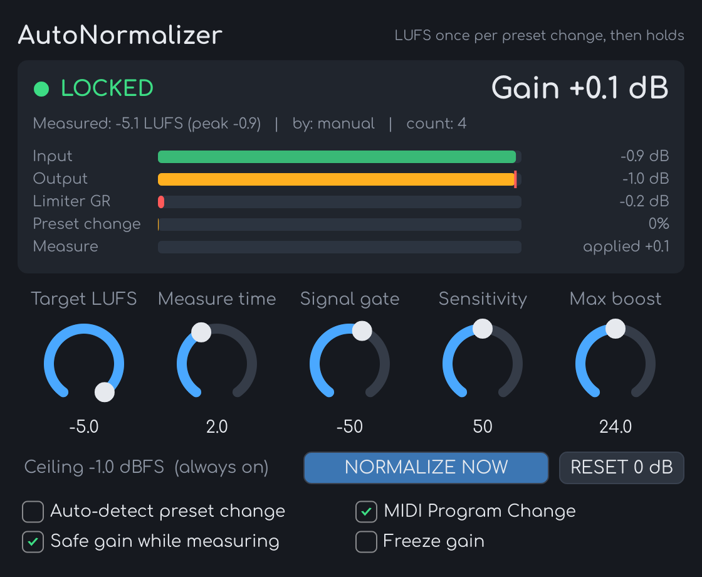

# AutoNormalizer

Plugin audio (**AU, VST3, VST2**) che porta il volume del plugin che lo precede a un livello di **loudness in LUFS** (default **−14 LUFS**) **una sola volta per ogni cambio di preset**, poi blocca il guadagno e smette di misurare. L'uscita **non supera mai −1 dBFS**.



Non è un compressore né un AGC: dopo la misura il guadagno resta **fisso**. L'unica cosa che lavora sempre è il limiter di sicurezza a −1 dBFS, che interviene solo sui picchi che supererebbero quella soglia.

```
[ Synth / Effetto ] ──► [ AutoNormalizer ] ──► resto della catena
```

## Come funziona

1. **Rilevamento del cambio preset**
2. **Attesa del segnale**: se c'è silenzio aspetta finché il segnale non supera il *Signal gate*.
3. **Misura della loudness**: analizza *Measure time* secondi di segnale attivo (il silenzio non viene contato) e calcola la loudness in LUFS con la pesatura K dello standard ITU-R BS.1770, la stessa usata da Spotify, YouTube e dai loudness meter.
4. **Normalizzazione**: calcola `guadagno = Target LUFS − LUFS misurati` e lo applica con una rampa di 20 ms, senza click.
5. **Blocco** (`LOCKED`): la misura si ferma e il guadagno resta fisso fino al prossimo cambio preset.

### Tetto a −1 dBFS

Dopo il guadagno c'è un **limiter brick-wall con look-ahead di 1,5 ms**, sempre attivo e non disattivabile. Garantisce che **nessun campione in uscita superi −1 dBFS**, in ogni situazione:

- un target LUFS alto su un suono con transienti forti;
- note suonate dopo la misura molto più forti di quelle misurate;
- un preset nuovo molto più forte mentre la misura è ancora in corso.

Il look-ahead fa sì che il limiter abbassi il guadagno *prima* del picco, quindi non taglia la forma d'onda e non distorce. Nei test il clamp di emergenza finale non scatta mai: il tetto lo rispetta il limiter da solo. La latenza di 1,5 ms (71 campioni a 48 kHz) viene comunicata alla DAW, che la compensa automaticamente.

Il tetto riguarda i campioni (*sample peak*, dBFS). I picchi tra un campione e l'altro (*true peak*) possono superarlo di qualche decimo di dB dopo la conversione. Per l'uso in DAW è normale, e −1 dBFS lascia comunque margine.

L'indicatore **Limiter GR** nell'interfaccia mostra quanto sta lavorando il limiter. Se si accende spesso vuol dire che il target LUFS è troppo alto per quel suono: abbassalo, per esempio a −16 o −18 LUFS.

Quando lo inserisci per la prima volta normalizza il primo suono che arriva. Quando riapri il progetto il guadagno salvato viene ripristinato senza rifare la misura.

### Come capisce che il preset è cambiato

Un plugin non può "vedere" dentro un altro plugin: la DAW li isola, e nessun formato (AU, VST, VST3) permette di leggere il preset del plugin precedente. AutoNormalizer quindi usa tre metodi, attivabili anche insieme:

| Metodo | Affidabilità | Come si usa |
|---|---|---|
| **Auto-detect** | buona, euristica | Confronta continuamente l'"impronta" del suono (spettro su 8 bande + livello) con quella memorizzata all'ultima normalizzazione. Se cambia in modo netto e stabile per almeno 300 ms, considera il preset cambiato. Suonare note diverse o con dinamiche diverse sullo stesso preset **non** fa scattare il rilevamento (vedi i test). |
| **MIDI Program Change** | 100 % | Se cambi preset con un messaggio Program Change, mandalo anche ad AutoNormalizer (in AU è di tipo `aumf`, effetto con ingresso MIDI). |
| **Normalize Now** | 100 % | Pulsante nell'interfaccia oppure parametro automatizzabile/MIDI-learn `Normalize Now` (scatta sul passaggio off→on). Puoi collegarlo allo stesso controller che usi per cambiare preset. |

Se due preset hanno timbro e volume quasi identici, l'auto-detect può non accorgersene. In quel caso però non serve correggere il volume. Per avere controllo totale usa il Program Change o *Normalize Now*.

## Parametri

| Parametro | Default | Descrizione |
|---|---|---|
| Target Loudness | −14 LUFS | Loudness a cui portare ogni preset (da −40 a −5 LUFS) |
| Measure Time | 2 s | Secondi di segnale attivo da analizzare |
| Signal Gate | −50 dBFS | Sotto questa soglia il segnale conta come silenzio |
| Auto Detect | on | Rilevamento automatico del cambio preset |
| Sensitivity | 50 % | Più alta = scatta con differenze più piccole |
| MIDI Program Change | on | Un Program Change avvia la normalizzazione |
| Max Boost | +24 dB | Limite di amplificazione, per non alzare rumore o code |
| Safe Gain While Measuring | on | Durante attesa e misura abbassa subito il guadagno se il nuovo preset è molto più forte, così il limiter non deve schiacciarlo |
| Ceiling | −1 dBFS | Fisso e sempre attivo |
| Freeze Gain | off | Ignora qualunque trigger e mantiene il guadagno attuale |
| Normalize Now | — | Trigger manuale o automatizzabile |
| RESET 0 dB | — | Riporta il guadagno a 0 dB (unity) |

L'interfaccia mostra:

- lo stato (`LOCKED` / `WAITING FOR SIGNAL` / `MEASURING`);
- il guadagno applicato;
- gli ultimi LUFS misurati e il picco;
- chi ha fatto scattare la misura;
- i meter di ingresso e uscita (con il segno rosso a −1 dBFS);
- la riduzione del limiter;
- l'indicatore "Preset change": quando arriva al 100 % scatta il rilevamento automatico.

## Installer per macOS (.pkg)

Il modo più semplice: ogni push su GitHub fa partire la Action `AutoNormalizer`. Nella pagina della build trovi l'artifact **AutoNormalizer-macOS-Installer** con dentro `AutoNormalizer-<versione>-macOS.pkg`.

Per crearlo sul tuo Mac (servono Xcode Command Line Tools e CMake):

```bash
cd AutoNormalizer
```

```bash
cmake -B build -DCMAKE_BUILD_TYPE=Release && cmake --build build --config Release
```

```bash
./packaging/macos/make_pkg.sh
```

Il file finisce in `build/installer/AutoNormalizer-<versione>-macOS.pkg`. Caratteristiche dell'installer:

- binari universali, Intel e Apple Silicon (lo script lo verifica);
- puoi scegliere quali formati installare: AU, VST3 e VST2 se l'hai compilato;
- installa in `/Library/Audio/Plug-Ins/...`;
- forza il rescan degli Audio Unit, così Logic e GarageBand vedono subito il plugin.

**Firma.** Senza certificati Apple i plugin ricevono una firma ad-hoc e il .pkg non è firmato. Al primo avvio macOS lo blocca: fai **clic destro → Apri** sul .pkg, oppure vai in *Impostazioni di Sistema → Privacy e sicurezza → Apri comunque*. Per distribuirlo ad altri senza avvisi serve un account Apple Developer:

```bash
DEV_ID_APP="Developer ID Application: Nome (TEAMID)" DEV_ID_INSTALLER="Developer ID Installer: Nome (TEAMID)" NOTARY_PROFILE="mio-profilo" ./packaging/macos/make_pkg.sh
```

`NOTARY_PROFILE` si crea una volta sola con `xcrun notarytool store-credentials`. Lo script poi firma, notarizza e "graffa" il ticket al .pkg.

## Compilare

Servono CMake ≥ 3.22 e un compilatore C++17. JUCE 8.0.4 viene scaricato automaticamente, oppure lo indichi con `-DJUCE_DIR=...`.

```bash
cd AutoNormalizer
```

```bash
cmake -B build -DCMAKE_BUILD_TYPE=Release
```

```bash
cmake --build build --config Release
```

I file prodotti sono in `build/AutoNormalizer_artefacts/Release/`:

- `AU/AutoNormalizer.component` (solo macOS) → `~/Library/Audio/Plug-Ins/Components/`
- `VST3/AutoNormalizer.vst3` → `~/Library/Audio/Plug-Ins/VST3/` (mac) oppure `C:\Program Files\Common Files\VST3\` (Windows)
- `VST/AutoNormalizer.vst` / `.dll` → solo se abiliti il VST2 (vedi sotto)

### VST2

Steinberg non distribuisce più l'SDK VST2 e non è permesso ridistribuirlo, quindi non può essere incluso nel progetto. Se possiedi l'SDK legacy (`vstsdk2.4`, firmato prima del 2018), compila così:

```bash
cmake -B build -DCMAKE_BUILD_TYPE=Release -DVST2_SDK_DIR=/percorso/vstsdk2.4
```

### Test

```bash
ctest --test-dir build -C Release --output-on-failure
```

`tests/EngineTest.cpp` simula un plugin che cambia preset e verifica:

- misura LUFS corretta secondo BS.1770 (sinusoide di riferimento a −20 LUFS)
- normalizzazione al target
- rilevamento automatico del cambio preset
- nessun falso trigger cambiando note o dinamica o con pause di silenzio
- trigger MIDI
- **uscita mai sopra −1 dBFS** con transienti, note più forti dopo la misura, rumore e onda quadra a fondo scala
- guadagno sicuro durante la misura
- freeze
- ripristino del progetto
- latenza riportata

`tests/PluginTest.cpp` (`-DAN_BUILD_PLUGIN_TEST=ON`) prova il plugin vero e proprio: latenza riportata alla DAW, Program Change, automazione, tetto a −1 dBFS, salvataggio e ricaricamento dello stato, screenshot della GUI.

La GitHub Action `.github/workflows/autonormalizer.yml` compila su macOS, Windows e Linux, valida l'AU con `auval` e il VST3 con `pluginval`, crea l'installer `.pkg` e carica tutto come artifact scaricabile.
