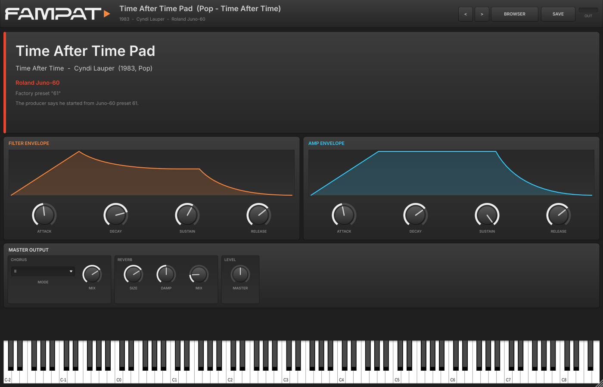
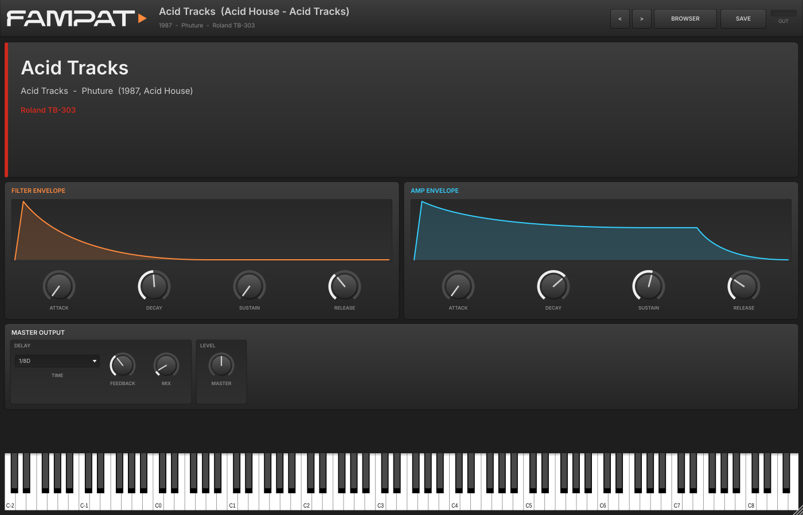
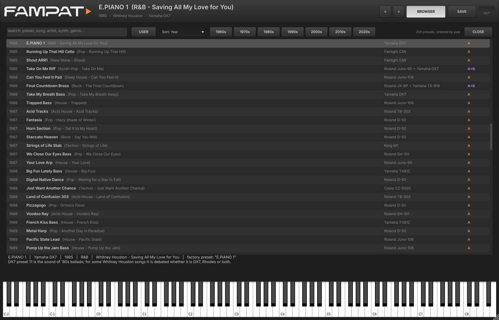
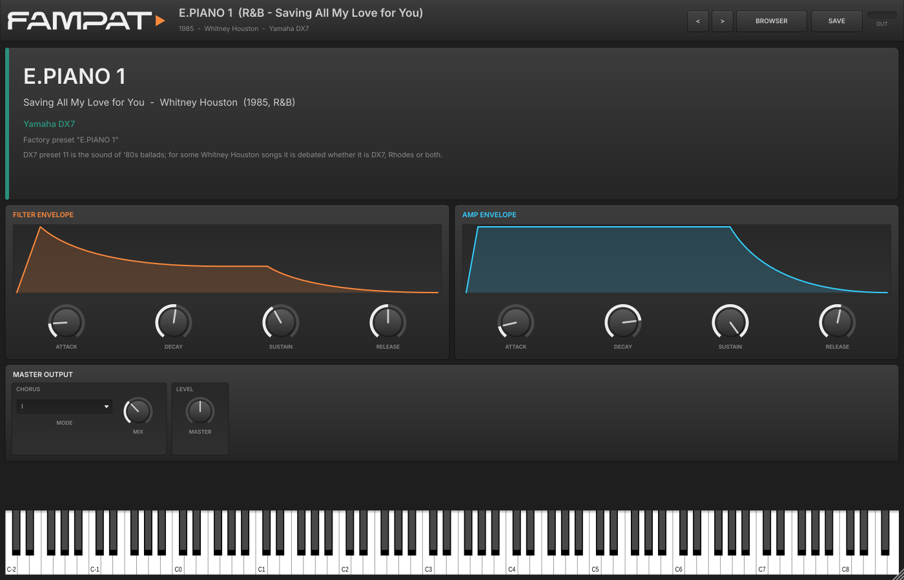
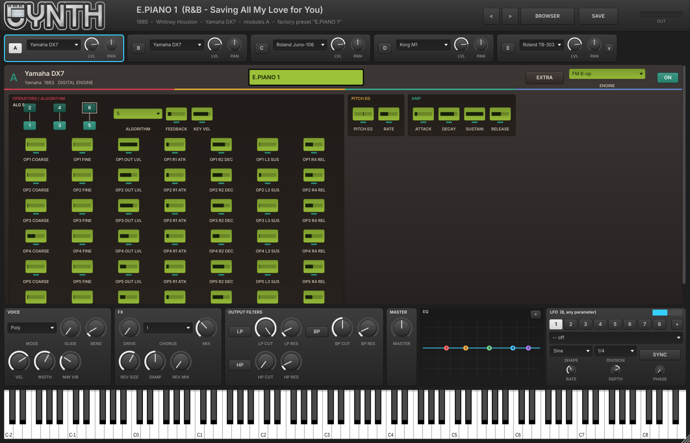
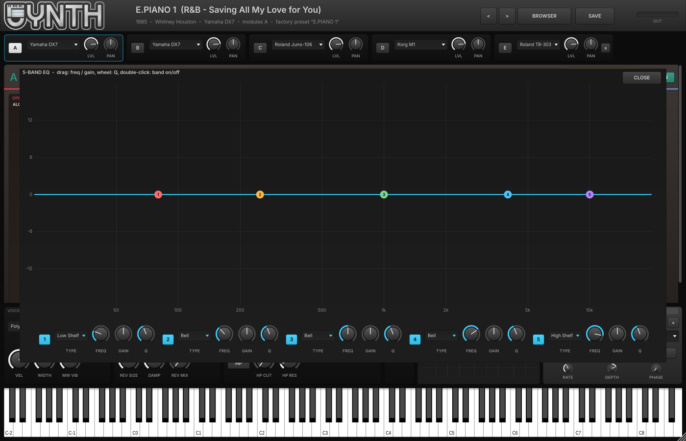

# FamPat — famous patches: 200 suoni di synth famosi 1963–2023 (VST3 / AU / Standalone)


**FamPat** (TMFU audiovibe, JUCE 8 / C++17) è un **player di preset**: 200 suoni di synth famosi ricreati **per sintesi** —
senza campioni — con i circuiti degli strumenti originali, ognuno legato al **brano più famoso che l'ha usato**.



**Manuale d'uso (PDF):** [docs/FamPat_Manuale_v1.0.0.pdf](docs/FamPat_Manuale_v1.0.0.pdf)

## Il player
- **Scheda della patch**: nome, brano, artista, anno, genere, strumento originale, preset di fabbrica, note sulle fonti.
- **FILTER ENVELOPE** e **AMP ENVELOPE** (Attack, Decay, Sustain, Release, con la curva): una coppia per tutta la patch; al
  caricamento partono dai valori della patch. Nelle patch a più synth sovrapposti muovono tutti gli inviluppi insieme
  (tempi in proporzione, sustain con lo stesso scarto).
- **MASTER OUTPUT**: gli effetti che la patch usa — Drive, Pedal (RAT / DS-1 / Tube), Chorus, Delay (a tempo), Reverb — e il
  **Level**. Nella DAW sono automatizzabili solo questi comandi.
- Testata con logo (clic = logo grande), frecce **< >**, **BROWSER** (ricerca, ordine per anno / canzone / preset / artista,
  decenni, frecce della tastiera) e **SAVE** / **USER** per i preset utente (`~/Library/Audio/Presets/TMFU audiovibe/FamPat`,
  file `.fampat`). Tastiera in basso, finestra ridimensionabile e a schermo intero.
- Il suono segue i comandi senza scalini né click; nessun click ai cambi di nota (Mono, Legato, Poly).

| | |
|---|---|
|  |  |

## Circuiti degli strumenti originali
Il circuito del filtro (e, dove conta, degli oscillatori e del convertitore) segue lo strumento scelto in Synth Model:
- **Moog** (Minimoog, modular, Polymoog, Source, Sub 37) e **ARP** (2500, 2600, Odyssey): ladder a transistor non lineare
  (modello di Huovilainen, saturazione per stadio, auto-oscillazione). Minimoog: forme d'onda originali (triangle, shark
  tooth, sawtooth, square, wide / narrow rectangle) e contorni Attack / Decay / Sustain con l'interruttore **DECAY**.
- **Roland** (Juno-60/106, Jupiter-8, SH-101, JX-8P, Alpha Juno): IR3109 a 4 OTA; i DCO (Juno, JX-8P, Alpha Juno) non derivano.
- **TB-303**: diode ladder accoppiato a 4 poli con il passa-alto nell'anello di risonanza.
- **Oberheim OB-X**: filtro SEM a 2 poli (12 dB/ott, nessuna auto-oscillazione); **OB-Xa** e **Prophet-5**: CEM3320 a 4 poli.
- **Korg MS-20**: 2 poli con risonanza limitata da diodi che arriva all'auto-oscillazione; **Yamaha CS-80**: VCF a 12 dB.
- **EMS VCS3**: diode ladder; **PPG Wave 2.3**: wavetable a 8 bit che cambiano onda a scatti + filtro SSM2044.
- **Yamaha DX7 / TX-816 / DX21 / TX81Z**: DAC a 12 bit con esponente (rumore di quantizzazione che segue il livello).

## Preset
200 preset dal 1963 al 2023, **ordinati per anno**. Nel browser ogni riga è:
`anno  Nome preset  (Genere - Brano)   strumento   moduli`. Ricerca testuale e salti rapidi per decennio.
- **Nomi reali** dei preset di fabbrica quando il suono è un preset documentato (Organ 2, Piano 16', Universe, Lore, Ooh/Aah,
  Choir, E.PIANO 1, BASS 1, Lately Bass, Solid Bass, What The, Fantasia, Pizzagogo, Digital Native Dance, Staccato Heaven,
  Horn Section, Living Calliope, Metal Harp, ORCH5, ARR1, Vox Humana, Sandstorm, LD Screamer, preset "61" del Juno-60).
- Generi bilanciati (Pop, Rock, Synth-Pop, New Wave, Funk/Soul, R&B, Disco, Film, Hip-Hop, House, Techno, Acid, Trance,
  Eurodance, Rave, Dubstep, EDM, Indie, Synthwave…), nessun genere favorito.
- Quando lo strumento di un brano non è documentato con certezza, la scheda del preset lo dice.
- **Tutti i preset sono normalizzati con picco a −1 dBFS** (misurato offline con una frase standard per tipo di suono).

Elenco completo: [docs/PRESETS.md](docs/PRESETS.md).

| | | |
|---|---|---|
|  DX7 |  FM, 5 moduli |  TB-303 |
|  Juno-60 (fader) |  Browser |  EQ |

## Fonti della ricerca
[MusicRadar – 10 best synth presets](https://www.musicradar.com/news/the-top-10-classic-synth-presets-and-where-you-can-hear-them),
[MusicRadar – 10 best TB-303 tracks](https://www.musicradar.com/news/10-of-the-best-roland-tb-303-tracks-of-all-time-fatboy-slim-voodoo-ray-aphex-twin-and-more),
[Gearnews – 5 synth presets that changed pop music](https://www.gearnews.com/5-synth-presets-that-changed-pop-music-synths/),
[Reverb Machine – DX7 songs](https://reverbmachine.com/blog/exploring-the-yamaha-dx7-pt2/),
[Sonicstate – Korg M1 famous sounds](https://sonicstate.com/news/2024/07/22/korg-m1-famous-songs-sounds/),
[Roland – Sounds of the D-50](https://articles.roland.com/listening-guide-sounds-of-the-d-50/),
[Sound On Sound – Darude Sandstorm](https://www.soundonsound.com/techniques/classic-tracks-darude-sandstorm),
[MusicRadar – Sandstorm and the JP-8080](https://www.musicradar.com/artists/when-you-turn-on-the-roland-jp-8080-the-first-sound-that-comes-up-is-called-sandstorm-how-darude-created-the-era-defining-trance-anthem-thats-named-after-a-synth-preset),
[ClassicTrance – JP-8000 Supersaw](https://www.classictrance.com/blog/jp-8000-supersaw-rewrote-trance),
[MusicRadar – Blinding Lights](https://www.musicradar.com/how-to/how-the-weeknd-recreated-80s-sound-blinding-lights),
[American Songwriter – Juno-60](https://americansongwriter.com/3-songs-that-use-the-juno-60-the-synthesizer-that-made-80s-pop-music-sound-magical/),
[Thomann – fat synth songs](https://www.thomann.de/blog/en/15-songs-with-a-fat-synth-sound/),
[Splice – Korg songs](https://splice.com/blog/iconic-songs-korg-synthesizers/),
[KVR – Open303](https://www.kvraudio.com/forum/viewtopic.php?t=262829&start=330), [JC-303](https://github.com/midilab/jc303),
[ElectroSmash – ProCo RAT](https://www.electrosmash.com/proco-rat-analysis/pedals/distortion/pro-co-rat-distortion.html).

## Compilazione e installazione

```bash
cmake -S FamPat -B FamPat/build -DCMAKE_BUILD_TYPE=Release
```

```bash
cmake --build FamPat/build --config Release --parallel
```

Su macOS la CI (`.github/workflows/fampat.yml`, runner Intel) produce l'installer universale **FamPat-1.0.0-macOS.pkg**
(Intel + Apple Silicon: AU, VST3, app Standalone). Nella DAW compare sotto **TMFU audiovibe** come **FamPat** (AU `aumu Fmpt Tmfu`).

Strumenti: `tools/gen_presets.py` (libreria + `docs/PRESETS.md`); `tools/make_manual.py <versione>` (manuale PDF);
test con `-DFAMPAT_BUILD_TESTS=ON`: `FamPatTest <dir> units | check | levels | clicks | smooth | wav <nome> | gui | logo`.

> Marchi e nomi degli strumenti appartengono ai rispettivi proprietari e sono usati solo per indicare lo strumento di
> riferimento. Font: vedi `resources/fonts/FONTS-LICENSE.txt`.
