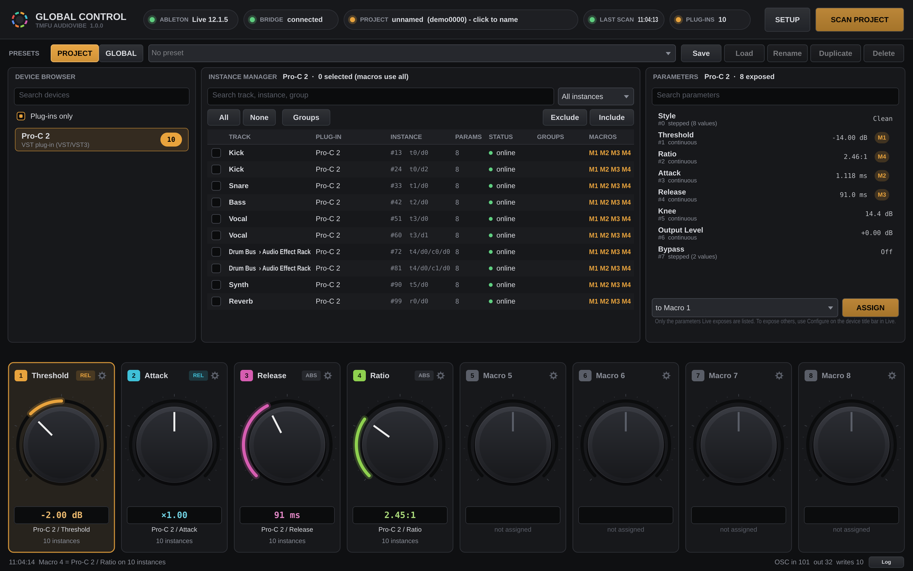
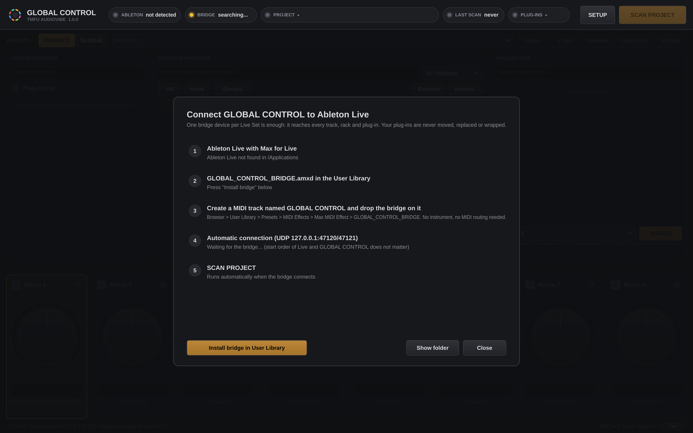

# GLOBAL CONTROL — Manuale d'uso (v1.0)

GLOBAL CONTROL muove **lo stesso parametro su più istanze originali di un plug-in** in Ableton Live, da 8 macro
knob, senza spostare, sostituire o incapsulare i device. L'app non elabora audio e non va inserita nel Master.

## 1. Installazione
1. Aprire `GLOBAL_CONTROL-1.0.0-macOS.pkg`: installa **GLOBAL CONTROL.app** in /Applications (universale Apple
   Silicon + Intel) e copia **GLOBAL_CONTROL_BRIDGE.amxd** (+ `gc_bridge.js`) nella User Library di Ableton,
   in *Presets › MIDI Effects › Max MIDI Effect*, solo se la cartella esiste e non contiene già file diversi.
2. Requisiti: macOS 11+, Ableton Live con Max for Live (Suite, oppure Standard + Max for Live).

## 2. Collegamento a Live (una volta per Live Set)
1. Aprire il Set in Live.
2. Creare una **traccia MIDI** chiamata `GLOBAL CONTROL`, senza strumento.
3. Trascinarci sopra **GLOBAL_CONTROL_BRIDGE** dal Browser (User Library). Un solo bridge per Set: raggiunge tutte
   le tracce, le return, il master e i rack annidati.
4. Avviare GLOBAL CONTROL (prima o dopo Live, l'ordine non conta). La connessione è automatica (UDP solo su
   127.0.0.1, porte 47120/47121) e la prima scansione parte da sola.

Il pannello **SETUP** (si apre da solo finché il bridge non è connesso) verifica Live/Max for Live, la presenza del
bridge nella User Library, la connessione e la scansione; può installare o aggiornare il bridge, chiedendo conferma
prima di sostituire un file esistente (ne conserva una copia `(backup)`).

## 3. Finestra principale
| Area | Funzione |
|---|---|
| **A · Stato** | Ableton (processo / versione), Bridge (connesso, in ricerca, perso), Progetto (clic per dargli un nome: Live non comunica il nome del Set), ultima scansione, numero di istanze di plug-in. **SCAN PROJECT** (⌘R) riesegue la scansione; avviene anche da sola quando aggiungi/rimuovi tracce o device. |
| **Preset** | PROJECT / GLOBAL, Save, Load, Rename, Duplicate, Delete. |
| **B · Device browser** | Plug-in del progetto con il numero di istanze; "Plug-ins only" mostra anche i device di Live se disattivato. |
| **C · Instance manager** | Istanze del plug-in selezionato: traccia (anche dentro i rack), id/posizione, parametri esposti, stato, gruppi, macro. Selezione singola, multipla (⇧/⌘), All/None, ricerca, filtro (selezionate, mappate, non mappate, escluse), **Groups** (crea, seleziona, rinomina, elimina), **Exclude/Include**. Un'istanza esclusa non viene mai mossa, neanche se appartiene a una macro. Le istanze salvate ma non ritrovate compaiono in rosso. |
| **D · Parameters** | Parametri **realmente esposti da Live** per quel plug-in, con valore attuale e stato (continuo, a passi, bloccato da una macro di rack, automatizzato). Selezione multipla → **ASSIGN** sui macro consecutivi a partire da quello scelto (doppio clic = assegna). |
| **E · Macro control** | 8 macro indipendenti. |

## 4. Assegnare un parametro
1. Nel Device browser scegliere il plug-in (es. Pro-C 2).
2. Nell'Instance manager selezionare le istanze (nessuna selezione = tutte le istanze non escluse), oppure un gruppo.
3. Nei Parameters selezionare uno o più parametri, scegliere "to Macro N", premere **ASSIGN**.

GLOBAL CONTROL legge la scala reale del parametro chiedendo al plug-in i testi del display su tutto il range
(es. dB lineari, ms logaritmici, rapporti, voci di menu) e imposta un range sensato.

## 5. Macro knob
- Trascinare (verticale/orizzontale) o rotella; **⇧ = regolazione fine**; **doppio clic = reset**; tasto destro = menu.
- Ingranaggio = impostazioni: nome, colore, Absolute/Relative, minimo/massimo (Absolute), variazione massima
  (Relative), inversione, precisione (decimali), sensibilità fine, Reset, Capture, Clear, stato di ogni istanza.
- **ABSOLUTE**: tutte le istanze ricevono lo stesso valore (es. Threshold -12 dB), ciascuna nei propri limiti. Se le
  istanze hanno valori diversi il display mostra *mixed*.
- **RELATIVE**: ogni istanza conserva il proprio valore di partenza e riceve la stessa variazione; centro del knob =
  valori iniziali. La variazione è additiva per le scale lineari (dB), moltiplicativa (in ottave, ×2 = +1 ottava) per
  quelle logaritmiche (ms, Hz), a passi per i parametri discreti/enumerati. Se un'istanza arriva al limite le altre
  continuano; tornando indietro ritrova esattamente la sua distanza. **Capture** rende i valori attuali il nuovo punto
  di partenza.
- Feedback: se muovi il parametro nella GUI del plug-in, con un controller o con l'automazione, il valore torna
  nell'app (`external` / `automation`); in Relative la partenza di quell'istanza viene ricalcolata, così il knob non
  la fa "saltare". Le conferme delle proprie scritture non vengono mai rimandate a Live (nessun feedback loop).
- Pallino giallo sul knob: istanze con valori diversi (Absolute) o valori in Live diversi da partenza + variazione
  (Relative, es. dopo il caricamento di un preset).

## 6. Preset e riapertura del progetto
- **Project preset**: legato al Set (id salvato dal bridge dentro il Set). Contiene mappature, parametri, gruppi,
  istanze escluse, modalità, valori iniziali e impostazioni delle macro.
- **Global preset**: modello per qualunque Set; al caricamento la macro controlla tutte le istanze di quel plug-in.
- Formato: JSON versionato (`"format": "GLOBAL_CONTROL_PRESET", "version": 1`) in
  `~/Library/Application Support/GLOBAL CONTROL/` (`Global/`, `Projects/<id>/`, `Sessions/<id>.json`).
- Lo stato corrente viene salvato automaticamente per ogni Set. Quando il Set viene chiuso e riaperto: il bridge si
  ricollega, l'app riconosce il progetto, riesegue la scansione, **riconosce le istanze** (gli id di Live cambiano a
  ogni apertura) per posizione, traccia, nome e ordine, ripristina le mappature riconosciute e **segnala** quelle non
  riconosciute o ambigue, senza mai associarle a un'istanza a caso.

## 7. Limiti (dipendono da Live, non aggirabili via Max for Live)
- Sono controllabili solo i parametri che Live espone: per i plug-in con molti parametri usare *Configure* sul titolo
  del device in Live.
- Il produttore del plug-in, il formato VST2/VST3 e il nome del Set non sono disponibili.
- Modifica dalla GUI del plug-in e da un controller esterno non sono distinguibili (entrambe `external`).
- Muovere un parametro automatizzato ne sovrascrive l'automazione, come un movimento manuale.
- Le scritture creano passi di annullamento in Live (il traffico è limitato a ~60 aggiornamenti/s per parametro).
