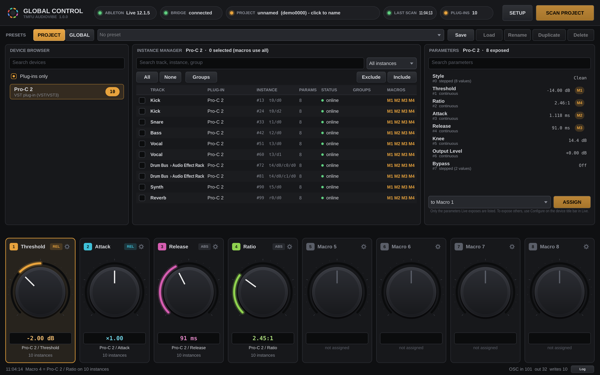

# GLOBAL CONTROL

Controllo centralizzato dei parametri dei plug-in **originali** in Ableton Live (macOS): 8 macro knob che muovono
lo stesso parametro su più istanze contemporaneamente (es. Threshold di 10 × FabFilter Pro-C 2), in modalità
**Absolute** o **Relative**, senza spostare, sostituire o incapsulare i device.



| Componente | Cosa fa | Dove |
|---|---|---|
| **GLOBAL CONTROL.app** | GUI, 8 macro, mapping, istanze e gruppi, preset, riconnessione (C++17 / JUCE 8, nessun audio) | `GlobalControlApp/` |
| **GLOBAL_CONTROL_BRIDGE.amxd** | Max MIDI Effect, **uno per Set** su una traccia MIDI dedicata; parla con il Live Object Model | `AbletonBridge/` |

Comunicazione: OSC su UDP, solo `127.0.0.1` (app :47120 ⇄ bridge :47121) — [protocollo](Protocol/OSCSpecification/GC_OSC_PROTOCOL.md).
📖 [Manuale d'uso](Documentation/USER_GUIDE.md) · 🔬 [Analisi tecnica e limiti](Documentation/TECHNICAL_ANALYSIS.md) · ✅ [Piano di test in Live](Documentation/TEST_PLAN.md)

## Stato (v1.0)

| Milestone | Stato |
|---|---|
| 1 · Analisi API Live / parametri VST3-AU | ✅ con le voci **[VERIFICA]** da confermare in Live |
| 2–6 · Bridge, scansione, controllo di 1 e 10 istanze, OSC bidirezionale | ✅ implementati e testati su LOM simulato |
| 7 · GUI standalone | ✅ dark/grafite, ridimensionabile: stato, device browser, instance manager, parametri, macro, preset, setup |
| 8 · 8 macro knob | ✅ nome, colore, plug-in, parametro, gruppo, valore, min/max, reset, inversione, precisione, fine |
| 9 · Absolute / Relative | ✅ scale lineari, logaritmiche, curve, discrete, enumerate; limiti per istanza; ribasamento dopo modifiche esterne |
| 10 · Preset e ripristino | ✅ Project/Global, Save/Load/Rename/Duplicate/Delete, JSON versionato, sessione automatica per Set, riconciliazione |
| 11 · Stabilità | 🟡 test automatici di riconnessione, cambio Set, cancellazione device; sessioni lunghe in Live da eseguire |
| 12 · Installer macOS | ✅ `.pkg` universale (app + bridge nella User Library senza sovrascritture), predisposto per firma e notarizzazione |

> **Importante:** il software è stato sviluppato e testato senza Ableton Live (ambiente Linux): i test automatici
> usano il bridge vero ma un Live Object Model **simulato** (`Tests/OSCtests/mock_live.js`, dati ipotetici).
> Prima del rilascio vanno eseguite le Fasi 1–10 di [TEST_PLAN.md](Documentation/TEST_PLAN.md) su un Mac con Live e
> Pro-C 2 reali, e confermate le voci **[VERIFICA]** (in particolare il formato `.amxd` generato da `tools/make_amxd.py`
> e la persistenza dell'id di progetto nel Set).

## Struttura

```
GLOBAL_CONTROL/
  GlobalControlApp/
    Core/            ParameterScale (scala misurata), AppController (logica app), BridgeInstaller
    Models/          ProjectModel (tracce, device, parametri dal LOM)
    MacroEngine/     MacroEngine (absolute / relative, ribasamento, default)
    MappingEngine/   InstanceReconciler (identità delle istanze tra sessioni)
    PresetEngine/    PresetStore (JSON versionato, sessioni per Set)
    OSC/             ProtocolCore (anti-duplicati, coalescing, blocchi, connessione), BridgeConnection (juce_osc)
    GUI/             LookAndFeel, MacroKnob, MacroInspector, Panels, MainComponent, Main
  AbletonBridge/
    LiveAPI/gc_bridge.js     OSC, Device Discovery, Parameter Discovery/Engine
    MaxPatch/                GLOBAL_CONTROL_BRIDGE.maxpat
    Build/                   GLOBAL_CONTROL_BRIDGE.amxd + gc_bridge.js (generati da tools/make_amxd.py)
  Protocol/OSCSpecification/ GC_OSC_PROTOCOL.md
  Tests/
    CoreTests/               C++ (ctest "core")
    OSCtests/                bridge su LOM simulato ("bridge"), app ⇄ bridge su UDP ("app_integration")
    AbletonIntegrationTests/ gc_poc.py - client per i test in Live reale
  Documentation/  USER_GUIDE.md, TECHNICAL_ANALYSIS.md, TEST_PLAN.md, images/, results/
  packaging/macos/  make_pkg.sh (installer .pkg), testi dell'installer, icona
                    (corrisponde a "Build/macOS" del capitolato: rinominato perché su macOS "Build" e la cartella
                    di compilazione "build" coinciderebbero)
  tools/          make_amxd.py, make_icon.py
```

## Compilare

```bash
python3 GLOBAL_CONTROL/tools/make_amxd.py
```

```bash
cmake -S GLOBAL_CONTROL -B GLOBAL_CONTROL/build -DCMAKE_BUILD_TYPE=Release && cmake --build GLOBAL_CONTROL/build --config Release --parallel
```

```bash
ctest --test-dir GLOBAL_CONTROL/build --output-on-failure
```

Installer (macOS, dalla cartella `GLOBAL_CONTROL`, dopo la build Release): `./packaging/macos/make_pkg.sh 1.0.0`.
La CI (`.github/workflows/globalcontrol.yml`) esegue i test su Linux e costruisce il `.pkg` universale su `macos-15-intel`.
JUCE 8.0.4 viene scaricato automaticamente (oppure `-DJUCE_DIR=...`).

## Limiti noti
- Il LOM non espone produttore del plug-in, formato VST2/VST3, nome/percorso del Set.
- Sono controllabili solo i parametri che Live espone (per plug-in con molti parametri: *Configure*).
- GUI del plug-in e controller esterno non sono distinguibili come origine di una modifica (entrambi `external`).
- Scrivere un parametro automatizzato ne sovrascrive l'automazione, come un movimento manuale.
