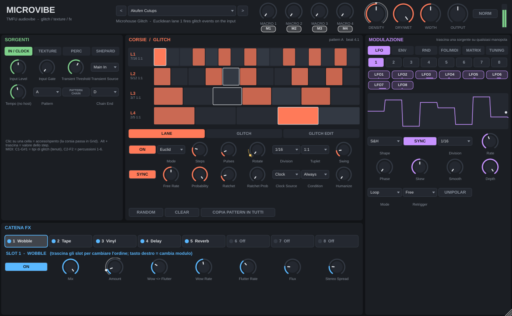

# MICROVIBE — glitch, texture e FX per minimal e microhouse (v1.1.0)

Plugin VST3 / AU / Standalone (JUCE 8, C++17) di **TMFU audiovibe**. È un *music effect*: lavora sull'audio della traccia,
riceve MIDI e ha generatori interni (texture, percussioni organiche, Shepard tone), quindi suona anche da solo.

📐 Progetto originale e stato dell'implementazione: [docs/PROGETTO.md](docs/PROGETTO.md)
📖 Manuale d'uso (PDF): [docs/Microvibe_Manuale_v1.1.0.pdf](docs/Microvibe_Manuale_v1.1.0.pdf)



## Flusso del segnale

```
 IN ──┬──────────────────────────────────────────────────────────────┐ (dry)
      │                                                              ▼
 TEXTURE ─┐                                                       DRY/WET ─► WIDTH ─► OUTPUT ─► NORM / limiter
 PERC  ───┼─► + ─► GLITCH ENGINE ─► FX 1 ─► FX 2 ─► … ─► FX 8 ───────┘
 SHEPARD ─┘
                ▲ tutto è modulabile: matrice 32 slot, 8 LFO, 4 ENV, 4 RANDOM, 2 FOLLOWER, step delle corsie, 4 MACRO, MIDI
                ▲ clock: 4 corsie poliritmiche (Euclid / Grid, tuplet, swing, probabilità, ratchet, condizioni)
```

## Sezioni

| Sezione | Contenuto |
|---|---|
| **IN / CLOCK** | livello e gate d'ingresso, rilevatore di transienti (ingresso principale o sidechain), tempo senza host, pattern A–H e catena |
| **TEXTURE** | letto di rumore (white / pink / brown / crackle) in un banco di risonatori accordati, drone con deriva, nuvola granulare sull'ingresso e/o sul letto (densità, dimensione, spray, pitch in scala, reverse, freeze, finestra) |
| **PERC** | 6 voci: sintesi modale (Wood, Glass, Metal, Skin, Tube, Stone, Plastic) con eccitatore Click / Noise / Mallet / **Input** (microsampling dell'ingresso), oppure **808** sintetizzati (Kick, Tom, Snare, Clap, Closed Hat, Open Hat con choke); per voce Level, Tune, Decay, **filtro HP / BP / LP** con Cutoff e Resonance, Material, Inharmonic, Position, Humanize, Probability, Every / Offset |
| **SHEPARD** | generatore Shepard–Risset (3–10 parziali, ottava / quinta / quarta / tritono / terza / intervallo libero in cent, su / giù / pendolo, sincronizzato in battute) |
| **CORSIE** | 4 corsie: lunghezza 1–64 (polimetro), divisione × tuplet 3:2, 5:4, 7:8, 11:8… (poliritmia), Euclid o griglia disegnata, rotazione, swing, probabilità, ratchet, condizioni (1:2, 1:4, Fill, First…), clock da transienti o MIDI, modalità libera in Hz |
| **GLITCH** | buffer di 8 s; eventi Repeat (roll con decay, pitch ramp, shrink), Reverse, Slice shuffle, Tape stop, Gate, Freeze, Crush, Dropout, Pitch, scelti a caso con pesi; durata in step; crossfade su ogni taglio |
| **CATENA FX** | 8 slot riordinabili trascinandoli: Tape (isteresi Jiles–Atherton 2×), Vinyl, Wobble (stile RC-20), Delay (Digital / Tape / Ping-Pong / Multitap poliritmico, pitch nel feedback, freeze, ducking), Reverb (FDN 8 linee: shimmer, freeze, gated, reverse), Filter (LP/HP/BP/Notch/Comb/Formant), Resonator, Ring / Freq shift, Crusher, Chorus, Phaser, Comp + transient shaper, Stereo, **Shepard FX** (filtro, phaser, flanger, notch infiniti) |
| **MODULAZIONE** | 8 LFO (anche a forma disegnata), 4 inviluppi, 4 random (S&H, smooth, drift, browniano), 2 envelope follower, step delle corsie, 4 macro, velocity / nota / mod wheel / aftertouch / pitch bend; matrice 32 slot con **Via** (moltiplicatore) e curva |
| **TUNING** | con TEXTURE → Chord = *Scale*: note del drone e del letto risonante scelte nella scala, **progressione di 4 accordi** (durate, unità sincronizzata o libera, ordine, glide, voicing); 20 scale interne (EDO 19/24/31/53, giusta intonazione, Bohlen-Pierce, pelog, slendro, maqam, Partch 43…), file **Scala .scl + .kbm**, client **MTS-ESP**; *Snap* quantizza tutti i pitch interni |

### Wobble come l'RC-20

Due LFO sinusoidali, **Wow** 0,1–4 Hz e **Flutter** 6–20 Hz, miscelati da un unico cursore *Wow ↔ Flutter* e scalati
da un solo *Amount*, applicati a una linea di ritardo frazionaria. **Flux** aggiunge una variazione casuale lenta di
velocità e profondità, così l'effetto suona meno da "LFO".

### Modulare qualsiasi cosa

- **Trascina** una sorgente (i chip colorati: LFO1, ENV2, RND3, M1…) su qualsiasi manopola: si crea uno slot della matrice.
  L'arco colorato attorno alla manopola mostra la profondità e il punto mostra il valore modulato in tempo reale.
- **Tasto destro** su una manopola: aggiungi / rimuovi modulazioni, valore di default.
- **Intermodulazione**: anche i parametri dei modulatori (rate, depth, forma, fase…) e gli *amount* della matrice sono destinazioni.
- **Via**: moltiplica la sorgente per una seconda sorgente (es. LFO 1 × Macro 2).

### MIDI

- Note **C1–G#1** (36–44): tengono premuto un tipo di glitch (Repeat, Reverse, Slice, Tape Stop, Gate, Freeze, Crush, Dropout, Pitch).
- Note **C2–F2** (48–53): suonano le percussioni 1–6.
- Ogni nota: velocity e numero di nota come sorgenti, trigger per inviluppi e LFO, clock per le corsie in modalità MIDI.

### Controlli

Frecce ↑/↓ su una manopola dopo un clic (Shift = passo fine), doppio clic = default, Shift + trascina = fine.
Nelle corsie: clic su una cella = acceso / spento (la corsia passa in *Grid*), Alt + trascina = valore dello step,
tasto destro sull'etichetta della corsia = Random / Svuota / Euclid ↔ Grid; clic sull'etichetta = corsia on/off.

### Stop della DAW

Quando premi stop si fermano texture, drone, Shepard, percussioni, glitch e corsie (dissolvenza di circa 30 ms); solo le code di
delay e riverbero si spengono in modo naturale. Nella Standalone il plugin suona sempre.

## Preset

180 preset in 12 categorie (15 ciascuna): Microhouse Glitch, Minimal Perc, Textures & Beds, Tape & Vinyl,
Wobble / Lo-fi, Dub Delays, Shepard Risers, Microtonal, Polyrhythm, Performance, 808 Minimal, Chord Drones. In tutti le **4 macro** sono collegate
(1 densità / glitch, 2 spazio, 3 sporcizia, 4 tono). Generati da `tools/gen_presets.py`, volumi calibrati a −16 dB
(`tools/levels.json`).

## Build

```bash
cmake -S . -B build -DCMAKE_BUILD_TYPE=Release
```

```bash
cmake --build build --config Release --parallel
```

Su macOS si ottengono AU + VST3 + Standalone universali (Intel + Apple Silicon). L'installer `.pkg` si crea con
`./packaging/macos/make_pkg.sh 1.1.0` (lo fa la CI, `.github/workflows/microvibe.yml`, insieme a `auval -v aumf Mcvb Tmfu`).

Test offline (render di tutti i preset, controlli di NaN / silenzio / clipping / CPU, test di unità, snapshot della GUI):

```bash
cmake -S . -B build-test -DCMAKE_BUILD_TYPE=Release -DMICROVIBE_BUILD_TESTS=ON && cmake --build build-test --target MicrovibeTest
```

```bash
build-test/MicrovibeTest_artefacts/Release/MicrovibeTest out units
```

```bash
build-test/MicrovibeTest_artefacts/Release/MicrovibeTest out check
```

## Crediti

- Client microtuning **MTS-ESP** di ODDSound (licenza 0BSD), in `third_party/MTS-ESP`.
- RC-20 Retro Color è un marchio di XLN Audio. Microvibe ne riprende solo il *comportamento* del modulo Wobble
  (documentato pubblicamente); non contiene codice, grafica o campioni di altri prodotti.
