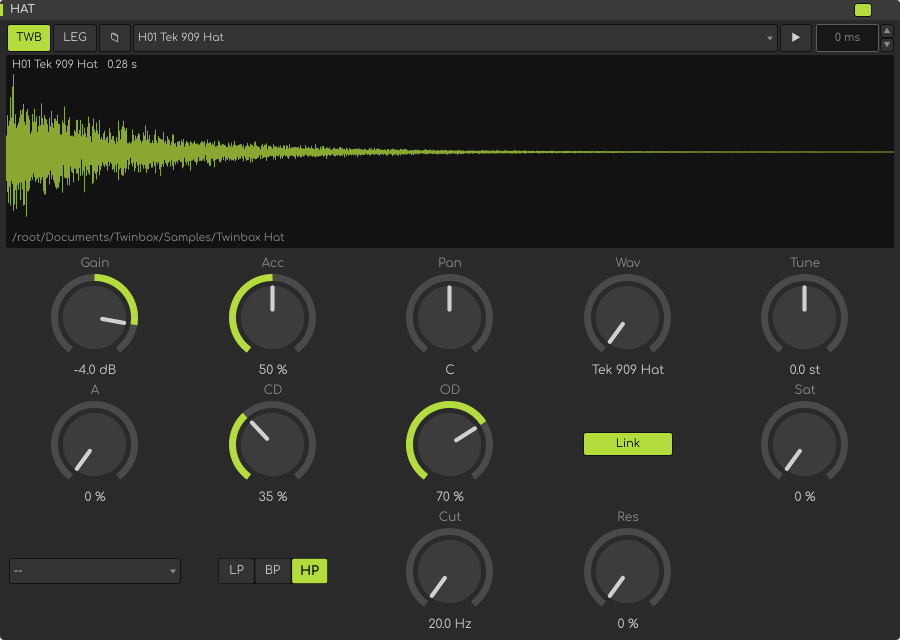

# TWINBOX — groovebox ibrida VST3 / AU (v2.1)

Twinbox è uno strumento VST3/AU (JUCE 8, C++17) che unisce due drum machine in un solo plugin:

| Sezione | Architettura di riferimento | Contenuto |
|---|---|---|
| **A — Drum Synth** (in alto) | Sonic Charge **Microtonic** | 8 canali di percussioni sintetiche, 12 pattern (A–L) fino a **64 step** con Trigger / Accent / Fill, Swing, Fill Rate, Morph |
| **B — Groovebox** (in basso) | NI Reaktor **Limelite 1.3** | 6 voci (Kick, Snare, Hat, Tie, Pod, **Pulp**), sequencer A–D fino a **64 step** con catena di pattern e motore **Remix**, effetti Filter / EQ / Magic / Delay / xFx (23 modi) / Mix / Out |
| **GLOBAL CONTROL** (a destra, comprimibile) | — | Crossfader A↔B, filtro master **Cutoff** (manopola grande) HP/BP/LP + **Resonance**, Master, Tempo / Run |


> Microtonic è un marchio di Sonic Charge; Reaktor e Limelite sono marchi di Native Instruments. Twinbox è un progetto
> indipendente che riprende l'*architettura* e l'organizzazione dei controlli di questi strumenti. Non contiene codice,
> grafica o campioni originali. I campioni originali di Limelite si possono importare solo dal proprio file `.ens`
> (vedi "Cartelle Legacy").

## Flusso del segnale

```
 A: 8 voci sintetiche ─► Level A ───────────────────────────────┐
                                                               ├─► Mix A/B ─► Cutoff (HP/BP/LP + Res) ─► Master
 B: Kick Snare Hat Tie Pod Pulp ─► Filter ─► EQ/Sat ─► Magic ─┬─┘
                                   └─► Delay ─► xFx ─► FX Mix ┘ ─► Dirt ─► Norm ─► Gain (= Level B)
```

Il crossfader è lineare: al centro hai il 50 % di A e il 50 % di B.

## Sezione B — fedele a Limelite 1.3

Parametri, nomi e organizzazione vengono dall'analisi del file originale (dettagli in [`docs/limelite_analysis.md`](docs/limelite_analysis.md)).

**SEQUENCER**
- Pattern A–D.
- Griglia KICK / SNARE / C-HAT / O-HAT: clic = acceso/spento, tasto destro = accento (quadrato grande).
- Corsie a valori TIE / POD / MOD a barre: 0 = spento, la linea centrale di TIE è la nota base.
- 64 step in 4 pagine.
- Catena di pattern: **ON**, lunghezza, 8 slot A–D, **LOCK**. Più COPY / PASTE.

**REMIX**
- **NOW!**, **SHIFT**, **REMIX** (127 schemi di variazione), Rate (OFF / 2 / 4 / 8 / 12 / 16 battute).
- SWING, **1/2** (metà tempo), START, lunghezze LEN / TIE / POD / MOD con **Stretch**.

**OUT**: DIRT, GAIN, TUNE, NORM con AMP / REL / SM.
- **DIRT** è una saturazione morbida, nello stile "gentle saturation": curva lineare sui segnali deboli che arrotonda solo i picchi, armoniche pari leggere, compensazione di livello. A valori bassi è quasi trasparente.

**GLOBAL**: CLK, BPM.

**Le voci**

| Voce | Controlli |
|---|---|
| **Kick** | GAIN, ACC, PAN, **WAV** (selezione campione), TUNE, ST, H, D, SAT, SHP, SM, MOD (`-- / wav / tune / cut`), LO (low cut), CUT, RES |
| **Snare** | come il Kick, con filtro LP/BP/HP al posto del low cut, MOD anche su `flam`, e il controllo FLAM |
| **Hat** | GAIN, ACC, PAN, TUNE, CD, OD, LINK, MOD, CUT (passa-alto), RES. Un solo campione; il partner "open" è opzionale |
| **Tie** | voce tonale: GAIN, V>A, PAN, TUNE, PORT, ST, A, D, FM, MP, NOISE, SAT, VEL (`wav / tune / att / dcy / st / fm / cut`), filtro LP/BP/HP, CUT, RES |
| **Pod** | GAIN, V>A, PAN, TUNE, ST, A, D, ZAP, VEL (`wav / tune / att / dcy / zap / cut`), filtro, CUT, RES |
| **Pulp** | oscillatore che segue l'intonazione: TUNE, PORT, GAIN, PAN, **sorgente d'ingresso** (Kick / Snare / Hat / Tie / Pod / All), **IN GAIN**, LO, HI, D, OSC (Sine / Input / Noise), filtro comb COMB, FB, FREQ, FM, CUT. Pulp viene riattivato dai colpi della sorgente scelta e ne segue l'altezza |

**Effetti**
- **XFX**: il pad XY ha un **registratore di movimento**. Con **● REC** acceso, trascina il pad: il movimento viene registrato in un loop lungo **LEN** (da 1/16 a 4 battute), alla velocità **SPD**. **▶ PLAY** lo ripete a tempo, e **SM** ammorbidisce la riproduzione. Modi disponibili: off, highpass, bandpass, lowpass, phaser, vowel, flanger, fm, reson, feedback, reflex, reverb, ufo, rainman, distort, ringmod, lofi, pitchshift, gate, chop, slice, freeze, spin. Si controlla con un pad XY, più DLY, GAIN, LO, HI, SPD, LEN, SM e i tasti ▶ / ●.
- **DELAY**: ONE, TWO (in sedicesimi), FB, GAIN, LFO, FM, DM, WIDE, CUT, RES, LO.
- **MIX**: FX MIX, MOD INPUT, MOD MIX.
- **EQ**: HI, MID, LO, AMP, SPLIT.
- **FILTER**: CUT, TRK, SM, MOD.
- **MAGIC**: PITCH, GR, MOD, RMX, MIX, NOTCH.

Ogni pannello si apre in una **finestra grande** (⤢):
- il sequencer, con 32 step per pagina e tutte e tre le corsie a valori visibili insieme;
- ogni sampler, con la forma d'onda;
- una finestra unica per Remix, Out e tutti gli effetti.

| | | |
|---|---|---|
|  |  |  |

## Campioni: cartelle per modulo

Ogni sampler (Kick, Snare, Hat, Tie, Pod) ha la manopola **WAV** e un menu per scegliere il campione. Legge **una cartella**, e il menu mostra solo i file di quella cartella.

| Pulsante | Cartella |
|---|---|
| **TWB** | `Twinbox Kick`, `Twinbox Snare`, … (libreria di fabbrica: 152 suoni sintetizzati, etichettati per genere; installata al primo avvio) |
| **LEG** | `Legacy Kick`, `Legacy Snare`, … (campioni originali di Limelite, vedi sotto) |
| **📁** | una cartella a tua scelta, impostabile per ogni modulo e salvata col progetto |

Posizione delle cartelle:
- macOS: `/Users/Shared/Twinbox/Samples`
- Windows: `C:\Users\Public\Documents\Twinbox\Samples`
- Linux: `~/Documents/Twinbox/Samples`

Per l'Hat, se esiste `open/<stesso nome>.wav` dentro la cartella, viene usato per l'hat aperto.

### Cartelle Legacy (omaggio a Limelite)

Premi **IMPORT LEGACY** nella sezione B e seleziona il **tuo** file `Limelite 1.3.ens`. Twinbox estrae le 6 mappe di campioni originali nelle cartelle `Legacy *`, con i nomi originali:
- Kick 128 campioni;
- Snare 128;
- Hat 127 chiusi + 127 aperti, abbinati;
- Tie 128;
- Pod 128.

I campioni restano solo sul tuo computer.

## Preset di genere: 128 per sezione

Ogni sezione ha un pulsante **BROWSER**. I preset sono 16 per ciascuno degli 8 generi: Techno, Minimal, Microhouse, Rominimal, Chicago House, Tech House, Deep House, Breakbeat.

- **Sezione A**: kit di 8 drum patch con nomi + pattern (fino a 64 step), swing e fill rate. Il pattern viene caricato nello slot corrente.
- **Sezione B**: snapshot completo (campioni, voci, effetti, lunghezze, swing, Remix) + pattern A–D.
- Opzioni: caricare solo il kit, solo i pattern, e impostare il tempo.
- I livelli degli effetti dei preset B sono calibrati: ogni effetto (Delay, xFx, Magic) aggiunge al massimo **+2,5 dB** RMS rispetto al segnale dry. Il ricalcolo si fa con `TwinboxTest <out> "" calibrate resources/presets_B.json resources/presets_B.json`.

Il Rominimal segue i riferimenti indicati (Villalobos, Bauch, Barac, Ohm Hourani, Sublee, Zavor, 118–130 BPM):
- groove lunghi da 32 o 64 step;
- poca snare;
- percussioni legnose fuori griglia;
- sub che rotola con portamento;
- swing e delay dub;
- poliritmi fra le corsie.


## Clock e MIDI

- Con l'host in play il sequencer segue l'host. A trasporto fermo, oppure in Standalone, usa RUN (o CLK) al tempo impostato.
- Note MIDI della sezione A: 36–43 → canali A1–A8.
- Note MIDI della sezione B: 48–54 → Kick, Snare, Hat chiuso, Hat aperto, Tie, Pod, Pulp.

## Compilazione

```bash
cmake -B build -DCMAKE_BUILD_TYPE=Release
```

```bash
cmake --build build --config Release --parallel
```

JUCE 8.0.4 viene scaricato in automatico.
- Su macOS si ottengono **AU + VST3** universal (Intel + Apple Silicon).
- Su Windows e Linux si ottiene il VST3.

Il workflow `.github/workflows/build.yml`:
- compila le tre piattaforme;
- su macOS verifica l'AU con `auval`;
- produce l'installer **`Twinbox-2.1.0-macOS.pkg`** (artifact `Twinbox-macOS-Installer`).

Gli script che generano campioni e preset (`resources/`) sono `tools/gen_samples.py` e `tools/gen_presets.py`.

### Test

```bash
cmake -B build -DTWINBOX_BUILD_TESTS=ON
```

```bash
cmake --build build --target TwinboxTest
```

```bash
xvfb-run ./build/TwinboxTest_artefacts/Release/TwinboxTest ./out [percorso/Limelite 1.3.ens] [fuzz]
```

Cosa controlla il test:
- il rendering della sezione A, della sezione B e del filtro master;
- tutti i 23 modi xFx;
- i 256 preset;
- il salvataggio e ripristino dello stato;
- l'importazione Legacy, se passi il file `.ens`;
- gli screenshot di tutte le finestre.

L'opzione `fuzz` imposta parametri a caso, a frequenze di campionamento e dimensioni di blocco diverse.

## Note e limiti

- **EXT / FX** di Limelite (ingresso audio esterno, modalità solo-effetto) non sono implementati: il plugin è uno strumento senza ingresso audio.
- I 127 schemi di Remix e alcune curve dei parametri sono ricostruzioni: le tabelle numeriche originali non sono leggibili dal file.
- Su **Linux**, pluginval va saltuariamente in crash nel proprio codice di hosting VST3 (run loop Linux dell'host, nessun frame nel codice di Twinbox). Il plugin compilato con AddressSanitizer passa sempre la validazione.
