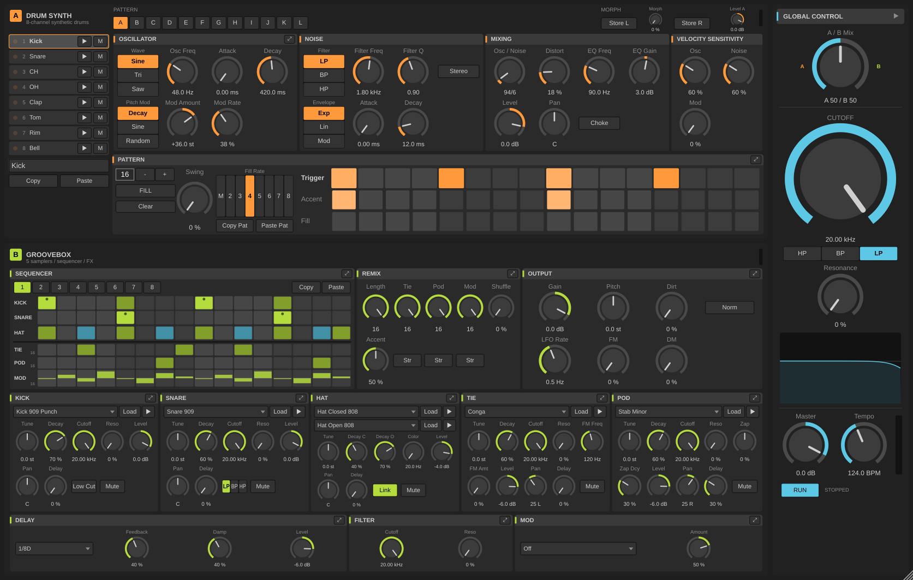
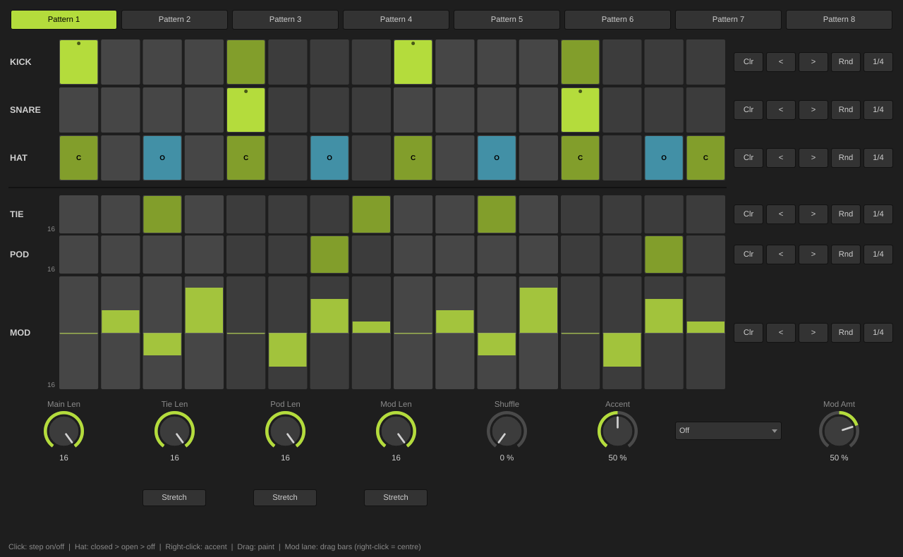
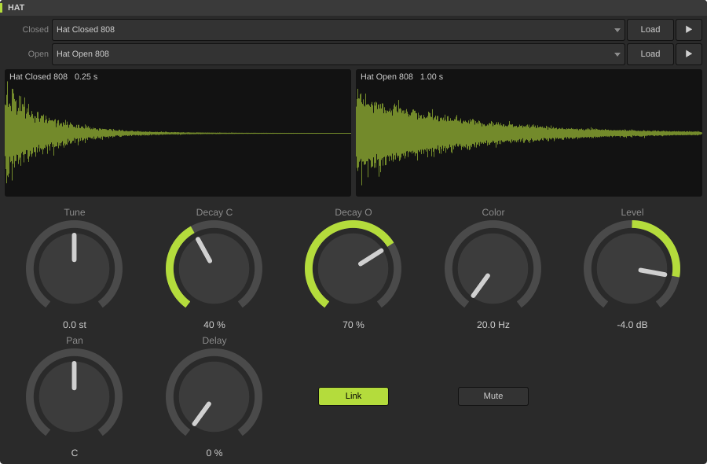
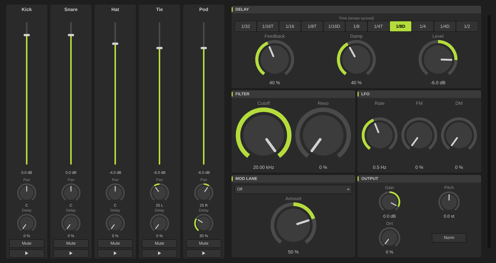
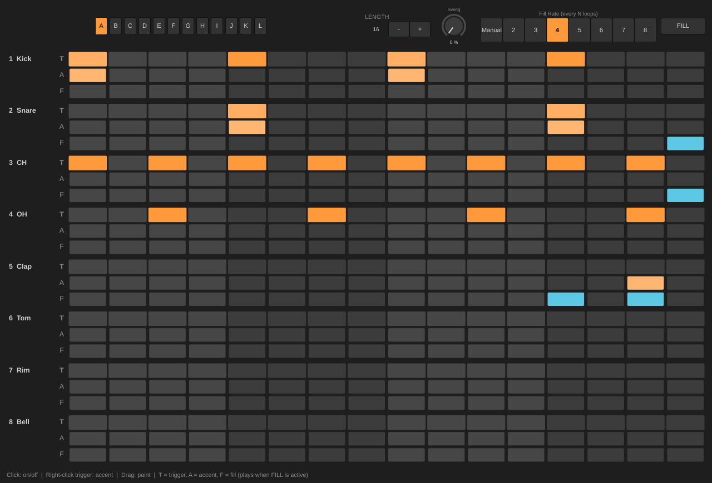
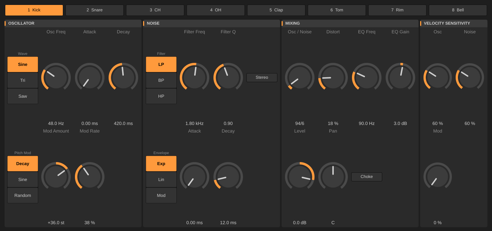
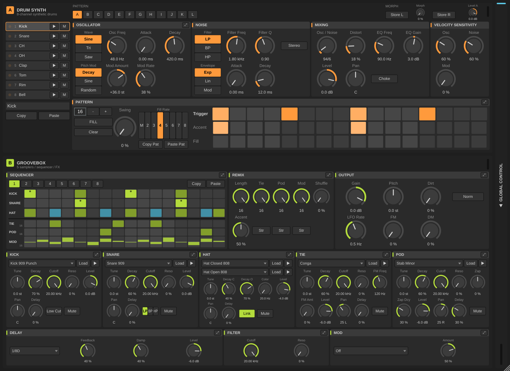

# Twinbox — groovebox ibrida VST3 / AU

Twinbox è uno strumento VST3/AU (JUCE 8, C++17) che riunisce due drum machine in un solo plugin:

| Sezione | Modello di riferimento | Contenuto |
|---|---|---|
| **A — Drum Synth** (in alto) | Sonic Charge **Microtonic** | 8 canali di percussioni sintetiche (oscillatore + rumore), pattern A–L da 16 step con Trigger / Accent / Fill, Swing, Fill Rate, Morph |
| **B — Groovebox** (in basso) | NI Reaktor **Limelite** | 5 campionatori (Kick, Snare, Hat, Tie, Pod), sequencer principale + finestra inferiore (Tie / Pod / Mod) con Remix (lunghezze e Stretch), Output (Gain, Pitch, Dirt, Norm, LFO FM/DM), Delay, Filtro |
| **GLOBAL CONTROL** (a destra, comprimibile) | — | Crossfader A↔B, filtro master **Cutoff** (manopola grande) con modo HP/BP/LP e **Resonance**, Master, Tempo / Run |



> Microtonic è un marchio di Sonic Charge; Reaktor e Limelite sono marchi di Native Instruments. Twinbox è un progetto
> indipendente che riprende l'*architettura* e l'organizzazione dei controlli di questi strumenti. Non contiene codice,
> grafica o campioni originali.

---

## Flusso del segnale

```
 Sezione A (8 voci sintetiche) ──► Level A ──┐
                                             ├─► Mix A/B ─► Filtro Cutoff (HP/BP/LP + Resonance) ─► Master ─► Out
 Sezione B (5 sampler ► Delay ► Filtro ►     │      0 %   = 100 % A
            Dirt ► Norm ► Gain) ─────────────┘      50 %  = 50 % A + 50 % B
                                                    100 % = 100 % B
```

* Il crossfader è lineare: `out = A·(1−x) + B·x`. Al centro hai esattamente 50 % di A e 50 % di B.
* Il filtro master è uno state-variable TPT a 2 poli (Zavalishin) con cutoff smussato: niente click quando lo muovi.
  In LP con cutoff al massimo (o in HP al minimo) il filtro viene saltato del tutto e il segnale passa intatto.

## Sezione A — Drum Synth (architettura Microtonic)

Ogni canale ha una *drum patch* completa, con tutti i parametri automatizzabili:

* **Oscillator**: Wave (Sine / Triangle / Saw), Osc Freq, Attack, Decay; **Pitch Mod** con modo Decay / Sine / Random, Amount (±96 semitoni) e Rate.
* **Noise**: filtro LP / BP / HP con Freq e Q, Stereo, inviluppo Exp / Lin / Mod (Mod = raffiche tipo clap), Attack e Decay.
* **Mixing**: Osc/Noise mix, Distort, EQ (Freq e Gain ±40 dB), Level, Pan, Choke.
* **Velocity Sensitivity**: Osc, Noise e Mod (0–200 %).
* **Canali**: nome rinominabile (doppio clic), Mute, ascolto ▶, Copy / Paste della patch.
* **Pattern**: 12 pattern (A–L) da 16 step con lunghezza per pattern. Ogni step ha Trigger, Accent (velocity 127 invece di 64) e Fill.
  Il cambio di pattern scatta alla fine del pattern in corso. Ci sono anche Swing, **Fill Rate** (Manual oppure ogni 2…8 giri) e il pulsante FILL.
* **Morph**: `Store L` e `Store R` memorizzano due set di 8 patch; la manopola Morph interpola fra i due (i parametri a scelta commutano al 50 %).
* **Finestre grandi** (pulsante ⤢):
  * **Pattern Editor**: tutti gli 8 canali × Trigger/Accent/Fill insieme, con selettore di pattern, lunghezza, Swing, Fill Rate e Fill.
  * **Drum Patch Editor**: tutte le manopole della patch in formato grande, con selettore di canale.

## Sezione B — Groovebox (architettura Limelite)

Organizzazione come nell'originale, su quattro aree:

1. **Sequencer** (in alto a sinistra)
   * Finestra principale: Kick / Snare / Hat su 16 step. Sull'Hat il clic cicla chiuso → aperto → spento; il tasto destro mette l'accento.
   * Finestra inferiore: corsie Tie e Pod, più la corsia **Mod** (un valore per step, assegnabile liberamente).
   * Otto slot pattern con Copy / Paste.
2. **Remix**: lunghezze Length (principale), Tie, Pod e Mod. Sotto le tre lunghezze secondarie ci sono i pulsanti **Stretch**, che allungano la sequenza fino alla lunghezza principale. Completano l'area Shuffle e Accent.
3. **Output**: Gain, Pitch (±12 semitoni), **Dirt** (distorsione), **Norm** (massimizzatore di volume), più l'LFO con Rate, **FM** (modula il cutoff del filtro) e **DM** (modula il tempo di delay).
4. **Sampler**:
   * **Kick**: Tune, Decay, Cutoff (LP), Reso, Low Cut.
   * **Snare**: gli stessi controlli del Kick, ma il filtro è LP / BP / HP.
   * **Hat**: due campionatori (Closed e Open) con **Link**: in modalità choke l'aperto viene tagliato dal chiuso.
   * **Tie**: FM da oscillatore (FM Freq, FM Amt).
   * **Pod**: **Zap**, cioè FM da inviluppo di decadimento (Zap, Zap Dcy).
   * **Comuni a tutti**: Level, Pan, mandata Delay e Mute. Ogni sampler offre la scelta del campione di fabbrica, un pulsante **Load** per i tuoi WAV / AIFF / FLAC / OGG (accetta anche il trascinamento del file) e il tasto ▶ per l'ascolto.
5. **FX**:
   * **Delay**: ping-pong sincronizzato al tempo, con Time, Feedback, Damp e Level.
   * **Filter**: Cutoff e Reso.
   * **Mod**: destinazione e quantità della corsia Mod. Le destinazioni sono Tune, Decay e Cutoff dei sampler, Tie FM, Pod Zap, Filter, Delay Send e Delay Feedback.

**Finestre grandi** (⤢):

* **Sequencer**: griglia enorme con tutte le corsie, barre Mod alte e strumenti per corsia (Clear, shift ← →, Random, 1/4). Contiene anche lunghezze, Stretch, Shuffle, Accent e Mod.
* **Sampler**: una finestra per ciascuno dei 5 sampler, con la forma d'onda e manopole grandi.
* **Mixer, FX & Output**: 5 channel strip con fader, più Delay, Filter, LFO, Mod e Output.

| | | |
|---|---|---|
|  |  |  |
|  |  |  |

## Clock e MIDI

* Con il trasporto dell'host in play, i sequencer seguono la posizione e il tempo dell'host.
* A trasporto fermo, oppure in Standalone, il pulsante **RUN** nel pannello Global avvia il clock interno al **Tempo** impostato.
* Mappa delle note MIDI:
  * 36–43 (C1–G1): canali A1–A8.
  * 48–53 (C2–F2): Kick, Snare, Hat chiuso, Hat aperto, Tie, Pod.
* Sono circa 290 parametri, tutti automatizzabili. Lo stato salva anche pattern, nomi, morph, percorsi dei campioni utente e stato della UI.

## Compilazione

Serve CMake ≥ 3.22 e un compilatore C++17. JUCE 8.0.4 viene scaricato in automatico. Se preferisci usare una copia locale, mettila in `./JUCE` oppure passa `-DJUCE_DIR=…`.

```bash
cmake -B build -DCMAKE_BUILD_TYPE=Release
```

```bash
cmake --build build --config Release --parallel
```

I plugin compilati finiscono in `build/Twinbox_artefacts/Release/`:

| Sistema | Formati | Dove installarli |
|---|---|---|
| macOS (Xcode CLT) | **AU** + VST3 + Standalone (universal arm64/x86_64) | `~/Library/Audio/Plug-Ins/Components/Twinbox.component` e `~/Library/Audio/Plug-Ins/VST3/Twinbox.vst3` |
| Windows (VS 2022) | VST3 + Standalone | `C:\Program Files\Common Files\VST3\Twinbox.vst3` |
| Linux | VST3 + Standalone | `~/.vst3/Twinbox.vst3` |

Il formato AU si può compilare solo su macOS. Il workflow `.github/workflows/build.yml` compila tutte e tre le piattaforme su GitHub Actions e su macOS esegue anche `auval`.

Per Linux servono queste dipendenze:

```bash
sudo apt-get install libasound2-dev libfreetype-dev libx11-dev libxcomposite-dev libxcursor-dev libxext-dev libxinerama-dev libxrandr-dev libxrender-dev libfontconfig1-dev libgl1-mesa-dev
```

### Test offline

```bash
cmake -B build -DTWINBOX_BUILD_TESTS=ON
```

```bash
cmake --build build --target TwinboxTest
```

```bash
xvfb-run ./build/TwinboxTest_artefacts/Release/TwinboxTest ./out
```

Il test esegue il rendering di 8 s di audio in 6 configurazioni: solo A, solo B, 50/50, LP risonante, HP e BP. Controlla che non ci siano NaN e che ci sia segnale, verifica il round-trip dello stato e salva gli screenshot di tutte le finestre.

## Struttura del codice

```
Source/
  Params.h/.cpp              ID e layout di tutti i parametri
  PluginProcessor.*          clock host/interno, MIDI, mix A/B, filtro master, morph, stato
  PluginEditor.*             vista principale scalabile (A sopra, B sotto, Global a destra)
  dsp/MicroEngine.*          voce sintetica, sequencer A–L, swing/fill, choke
  dsp/LimeEngine.*           5 sampler, corsie con lunghezza/stretch, Mod lane, Delay/Filter/Dirt/Norm/LFO
  dsp/SampleBank.*           banca di campioni di fabbrica generata proceduralmente (56 suoni)
  dsp/Transport.h            scheduling degli step a precisione di campione (con swing)
  gui/LookAndFeel.*          stile flat "Live-like", Knob, Segmented, Panel, ExpandWindow
  gui/MicroSection.*         UI della sezione A + finestre Pattern e Patch
  gui/LimeSection.*          UI della sezione B + finestre Sequencer, Sampler e Mixer
  gui/GlobalPanel.*          GLOBAL CONTROL comprimibile + curva del filtro
tests/TestMain.cpp           render offline e snapshot della GUI
```

## Note di fedeltà e limiti noti

* **Campioni di Limelite**: la libreria originale (circa 640 campioni NI) non è ridistribuibile. Al suo posto c'è una banca
  di 56 suoni sintetizzati (kick, snare, clap, hat, percussioni, stab, FX). Con *Load* o il drag & drop puoi caricare i
  tuoi campioni.
* **Documentazione consultata**: i manuali ufficiali (Reaktor 5 Instrument Reference, cap. 3.5 Limelite; Microtonic User
  Guide) non erano raggiungibili dall'ambiente di sviluppo. Nomi e comportamenti vengono da estratti dei manuali e da
  guide di terze parti (Garnish), integrati con la conoscenza degli strumenti. Alcuni dettagli sono quindi
  un'interpretazione: le curve esatte dei Rate, il comportamento del Fill Rate (qui "ogni N giri del pattern") e le
  destinazioni della corsia Mod.
* Il Morph di Microtonic qui interpola i parametri delle patch. Non ricostruisce le patch originali di Sonic Charge.
