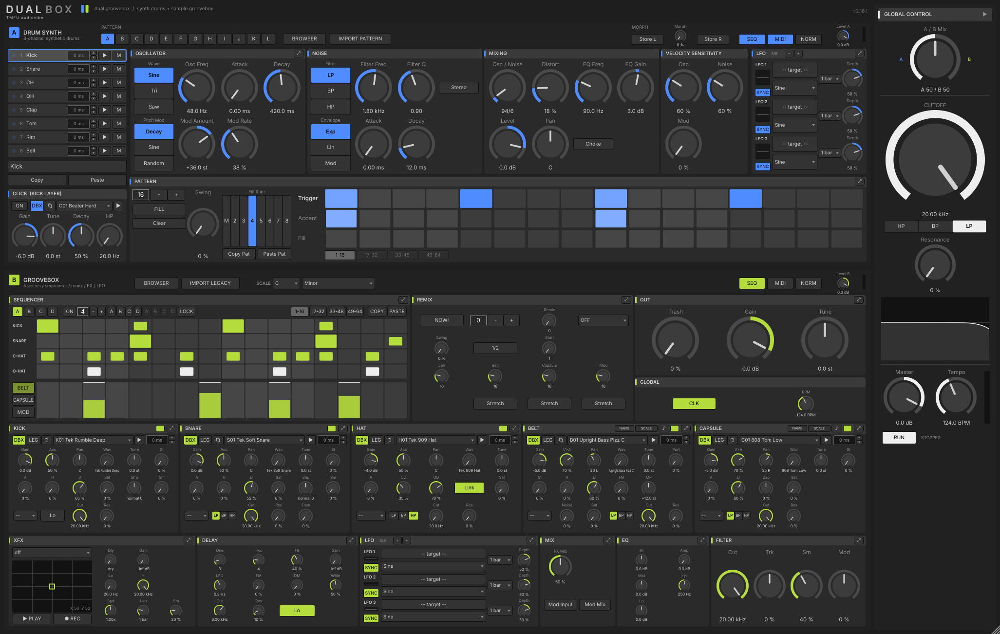
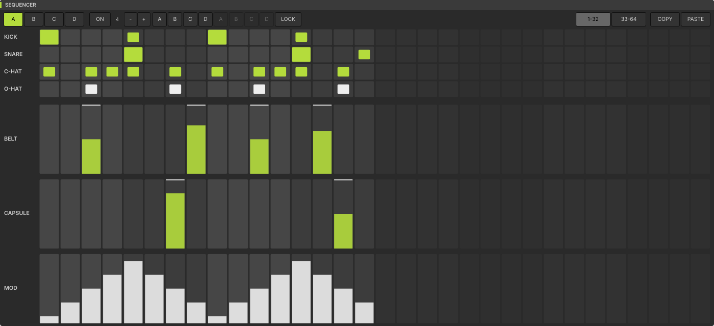
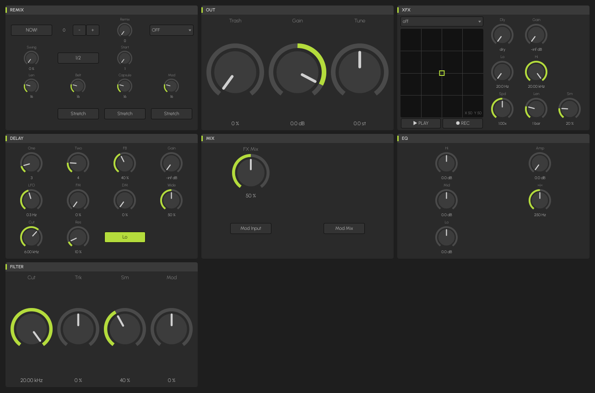
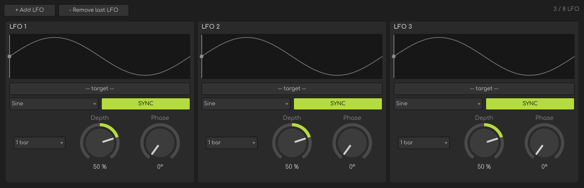
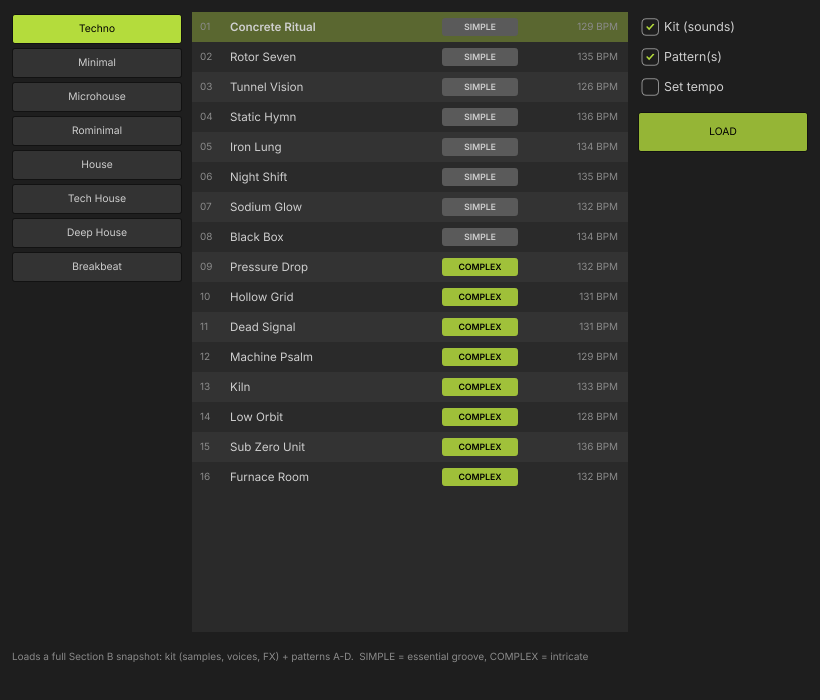

# TWINBOX — groovebox ibrida VST3 / AU (v2.13)

> Nello stesso repository: **[TWINSYNTH](Twinsynth/README.md)**, synth A (analogico) + D (digitale) con 321 preset dei suoni di synth più famosi 1960–2020.

Twinbox è uno strumento VST3/AU (JUCE 8, C++17) che unisce due drum machine in un solo plugin:

| Sezione | Architettura di riferimento | Contenuto |
|---|---|---|
| **A — Drum Synth** (in alto) | Sonic Charge **Microtonic** | 8 canali di percussioni sintetiche, 12 pattern (A–L) fino a **64 step** con Trigger / Accent / Fill, Swing, Fill Rate, Morph, **fino a 8 LFO** |
| **B — Groovebox** (in basso) | NI Reaktor **Limelite 1.3** | 5 voci a campioni (Kick, Snare, Hat, **Belt**, **Capsule**), sequencer A–D fino a **64 step** con catena di pattern e motore **Remix**, effetti Filter / EQ / Delay / xFx (23 modi) / Mix / Out, **fino a 8 LFO**, pulsanti **NORM** e **MIDI** |
| **GLOBAL CONTROL** (a destra, comprimibile) | — | Crossfader A↔B, filtro master **Cutoff** (manopola grande) HP/BP/LP + **Resonance**, Master, Tempo / Run |

📖 **Manuale d'uso completo (PDF):** [docs/Twinbox_Manuale_v2.13.0.pdf](docs/Twinbox_Manuale_v2.13.0.pdf)



> Microtonic è un marchio di Sonic Charge; Reaktor e Limelite sono marchi di Native Instruments. Twinbox è un progetto
> indipendente che riprende l'*architettura* e l'organizzazione dei controlli di questi strumenti. Non contiene codice,
> grafica o campioni originali. I campioni originali di Limelite si possono importare solo dal proprio file `.ens`
> (vedi "Cartelle Legacy").

## Novità 2.13

- Il knob **WAV** (scelta del campione) dei moduli B si muove con le frecce della tastiera.
- Risoluzione dei knob più fine: con le frecce **Pan** si sposta di 1, i parametri continui (Cutoff, Gain, Sat, ...) dello 0,2 % (Shift: 0,02 %); trascinamento col mouse più fine (1000 pixel per l'intera escursione).
- Nel browser della DAW il plugin compare sotto il produttore **TMFU audiovibe** (prima "Twinbox Audio").

## Novità 2.12

- Sezione A in **blu**, GLOBAL CONTROL in **bianco**. **Tie → Belt**, **Pod → Capsule**, **Dirt → Trash**. Tolti **Pulp** e **Magic**.
- Knob **A** (attacco) su Kick, Snare e Hat.
- **NORM** (A e B, nell'intestazione): normalizza l'uscita della sezione verso un livello medio costante e attiva un **limiter** a −1 dBFS; la spia rossa indica quando il limiter lavora.
- **MIDI** (A e B): la tastiera / i pad suonano la sezione scelta, una alla volta.
- **SEQ** (A e B): accende / spegne il sequencer della sezione, indipendentemente dal MIDI (spento = la sezione suona solo dalla tastiera).
- Volumi di A e B bilanciati (stesso livello medio) e limiter di sicurezza sull'uscita a −0,3 dBFS: niente clipping.
- Knob a risoluzione fine (Shift = ancora più fine) e controllabili con le **frecce** della tastiera dopo un clic (Pan a passi di 1, parametri continui a passi dello 0,2 %, knob WAV un campione alla volta); doppio clic al centro per Acc, V>A, Pan e Tune dei moduli B.
- Finestra ridimensionabile liberamente: massimizzata riempie tutto lo schermo (l'altezza decide la scala, la larghezza in più allarga le sezioni).
- Preset Minimal con suoni più rotondi.

## Flusso del segnale

```
 A: 8 voci sintetiche ─► Level A ───────────────────────────────┐
                                                               ├─► Mix A/B ─► Cutoff (HP/BP/LP + Res) ─► Master
 B: Kick Snare Hat Belt Capsule ─► Filter ─► EQ/Sat ──────┬─┘
                                   └─► Delay ─► xFx ─► FX Mix ┘ ─► Trash ─► Gain (= Level B) ─► NORM
```

Il crossfader è lineare: al centro hai il 50 % di A e il 50 % di B.

## Sezione B — fedele a Limelite 1.3

Parametri, nomi e organizzazione vengono dall'analisi del file originale (dettagli in [`docs/limelite_analysis.md`](docs/limelite_analysis.md)).

**SEQUENCER**
- Pattern A–D.
- Griglia KICK / SNARE / C-HAT / O-HAT: clic = acceso/spento, tasto destro = accento (quadrato grande).
- Corsie a valori BELT / CAPSULE / MOD a barre: 0 = spento, la linea centrale di BELT è la nota base.
- **Velocity per step su BELT e CAPSULE**: la tacca bianca nella colonna è la velocity della nota. **Alt/Option + trascina** la imposta, **Alt + ↑/↓** la cambia di 5 % (con Shift di 25 %). Vale anche con VEL = wav, e viene salvata con pattern e preset.
- 64 step in 4 pagine.
- Catena di pattern: **ON**, lunghezza, 8 slot A–D, **LOCK**. Più COPY / PASTE.

**NUDGE per traccia** (Sezione A: ogni canale nella colonna di sinistra; Sezione B: ogni modulo sample, a destra del menu del campione)
- Piccolo display in millisecondi con le frecce ▲▼: valori negativi = la traccia suona **in anticipo**, positivi = **in ritardo**, da −50 a +50 ms.
- ▲/▼ = ±1 ms (Shift ±0,1 ms, tieni premuto per ripetere); trascina sul display o usa la rotella; doppio clic = 0.
- Non aggiunge latenza: il sequencer legge le note con 51 ms di anticipo. Il nudge vale per le note del sequencer; le note MIDI in ingresso suonano subito. Caricare un preset non cambia il nudge.

**REMIX**
- **NOW!**, **SHIFT**, **REMIX** (127 schemi di variazione), Rate (OFF / 2 / 4 / 8 / 12 / 16 battute).
- SWING, **1/2** (metà tempo), START, lunghezze LEN / BELT / CAPSULE / MOD con **Stretch**.

**OUT**: TRASH, GAIN, TUNE. Il pulsante **NORM** è nell'intestazione della sezione (vedi sotto).
- **TRASH** è una saturazione morbida, nello stile "gentle saturation": curva lineare sui segnali deboli che arrotonda solo i picchi, armoniche pari leggere, compensazione di livello. A valori bassi è quasi trasparente.

**GLOBAL**: CLK, BPM.

**Le voci**

| Voce | Controlli |
|---|---|
| **Kick** | NUDGE, GAIN, ACC, PAN, **WAV** (selezione campione), TUNE, ST, H, D, SAT, SHP, SM, MOD (`-- / wav / tune / cut`), LO (low cut), CUT, RES |
| **Snare** | come il Kick, con filtro LP/BP/HP al posto del low cut, MOD anche su `flam`, e il controllo FLAM |
| **Hat** | GAIN, ACC, PAN, TUNE, CD, OD, LINK, **SAT**, MOD, filtro **LP/BP/HP** (default HP), CUT, RES. Un solo campione; il partner "open" è opzionale |
| **Belt** | voce tonale: GAIN, V>A, PAN, TUNE, PORT, ST, A, D, FM, MP, NOISE, SAT, VEL (`wav / tune / att / dcy / st / fm / cut`), filtro LP/BP/HP, CUT, RES |
| **Capsule** | GAIN, V>A, PAN, TUNE, ST, A, D, ZAP, **SAT**, VEL (`wav / tune / att / dcy / zap / cut`), filtro, CUT, RES |

**Effetti**
- **XFX**: il pad XY ha un **registratore di movimento**. Con **● REC** acceso, trascina il pad: il movimento viene registrato in un loop lungo **LEN** (da 1/16 a 4 battute), alla velocità **SPD**. **▶ PLAY** lo ripete a tempo, e **SM** ammorbidisce la riproduzione. Modi disponibili: off, highpass, bandpass, lowpass, phaser, vowel, flanger, fm, reson, feedback, reflex, reverb, ufo, rainman, distort, ringmod, lofi, pitchshift, gate, chop, slice, freeze, spin. Si controlla con un pad XY, più DLY, GAIN, LO, HI, SPD, LEN, SM e i tasti ▶ / ●.
- **DELAY**: ONE, TWO (in sedicesimi), FB, GAIN, LFO, FM, DM, WIDE, CUT, RES, LO.
- **MIX**: FX MIX, MOD INPUT, MOD MIX.
- **EQ**: HI, MID, LO, AMP, SPLIT.
- **FILTER**: CUT, TRK, SM, MOD.

Ogni pannello si apre in una **finestra grande** (⤢):
- il sequencer, con 32 step per pagina e tutte e tre le corsie a valori visibili insieme;
- ogni sampler, con la forma d'onda;
- una finestra unica per Remix, Out e tutti gli effetti.

| | | |
|---|---|---|
|  |  |  |

## LFO (da 1 a 8 per sezione)

Ogni sezione ha **fino a 8 LFO** (3 di default): i pulsanti **+** / **−** del modulo LFO li aggiungono o tolgono, con più di 3 LFO compaiono le pagine **1-3 / 4-6 / 7-8**; la finestra grande (↗) mostra tutti gli LFO attivi in griglia. Nella Sezione A il pannello LFO è a destra dell'editor dei suoni; nella Sezione B c'è un nuovo modulo **LFO** nella riga degli effetti. Ogni LFO può modulare **qualsiasi parametro della propria sezione**: 213 destinazioni in A, 180 in B.

- **Target**: menu diviso per gruppi (canali 1–8 / Kick, Snare, Hat, Belt, Capsule, Sequencer, Delay, xFx, EQ, Filter, Out). *-- (off)* spegne l'LFO.
- **Forme**: Sine, Triangle, Saw Up, Saw Down, Square, S&H, Random.
- **SYNC** acceso: divisioni musicali (8 bar … 1/32, terzine e puntati) agganciate alla posizione del brano. **SYNC** spento: **RATE** in millisecondi (10 ms … 30 s per ciclo).
- **Depth** da −100 a +100 % (100 % = metà dell'escursione del parametro in su e in giù), **Phase** 0–360° nella finestra grande (↗).
- La modulazione si somma al valore del knob, che resta dove l'hai messo. Le impostazioni sono automatizzabili, si salvano col progetto e non cambiano col caricamento dei preset. Il Morph della Sezione A non è modulabile.



## SCALE e intonazione dei campioni (Belt e Capsule)

- Al caricamento di una cartella Twinbox **rileva l'intonazione di ogni campione** in background (algoritmo YIN). Il risultato è nota + cent, oppure "no pitch". Il risultato viene memorizzato in un file nascosto `.twinbox_pitch.txt` nella cartella. L'audio non si interrompe: i nuovi campioni entrano in uso solo a analisi finita (128 campioni Legacy in circa 0,4 s, poi 0,04 s grazie al file).
- **SCALE** nell'intestazione della sezione B: Root e Scala, condivisi da Belt e Capsule. Le scale sono le stesse del dispositivo Scale di Ableton Live.
- **Tastiera**: clicca una colonna BELT, CAPSULE o MOD e usa le frecce. ↑ e ↓ cambiano il valore (con VEL = wav un campione alla volta, con ascolto e nome del campione); ← e → passano allo step precedente o successivo; Canc spegne lo step; Shift fa passi più grandi.
- **Selezione del campione con l'altezza della colonna** (Belt e Capsule con VEL = **wav**): ogni tacca della colonna BELT/CAPSULE corrisponde a un campione della lista, indipendentemente dal knob WAV. La prima tacca dal basso è l'ultimo campione della lista, quella più in alto è il primo. Con le altre impostazioni di VEL l'altezza resta la velocity (V>A). Ogni modulo usa al massimo 128 campioni per cartella.
- Il pulsante **NAME** di Belt e Capsule (presente anche nella finestra ♪) legge la tonalità **dal nome del file**. Esempi: "pad chord Db" → D♭, "Rhodes Cm9" → C, "Bass F#2" → F#2, "La minore" → A; sono riconosciuti C#/Db, sharp/flat, i nomi solfeggio Do…Si e l'ottava (C3 = 60). Serve per accordi e suoni che l'analisi audio non riesce a intonare. Se il nome non contiene una tonalità si usa l'analisi audio. Con NAME spento vale solo l'analisi audio.
- Il pulsante **SCALE** di Belt e Capsule porta ogni campione intonato sulla nota della scala più vicina. Con VEL = tune, le melodie delle corsie si muovono per gradi della scala.
- Con SCALE spento si è in **modalità MANUAL**. L'icona **♪** apre la finestra con tutti i campioni della cartella: per ognuno ci sono la nota rilevata, un pulsante ▶ e un knob da −32 a +32 semitoni, indipendente dal Tune del modulo. Il knob agisce in tempo reale anche durante la riproduzione, e le impostazioni vengono salvate nel progetto.

## Campioni: cartelle per modulo

Ogni sampler (Kick, Snare, Hat, Belt, Capsule) ha la manopola **WAV** e un menu per scegliere il campione. Legge **una cartella**, e il menu mostra solo i file di quella cartella.

| Pulsante | Cartella |
|---|---|
| **TWB** | `Twinbox Kick`, `Twinbox Snare`, … (libreria di fabbrica v5: 48 kick puliti, 48 snare e clap morbidi, 32 coppie di hat, 46 Belt con **solo bassi e accordi, tutti in Do** (bassi accordati su Do, accordi della famiglia Do minore), 66 Capsule con **tom 808 e 909 Hi/Mid/Low, conga 808 Hi/Mid/Low**, conga, bongo, tom, darbuka, cajon, claves, log drum, snare morbide e dissonant hit; una parte dei campioni viene da librerie gratuite CC0 / Public Domain, vedi [`resources/SAMPLE_CREDITS.md`](resources/SAMPLE_CREDITS.md); installata al primo avvio e aggiornata automaticamente quando esce una nuova libreria, senza toccare i file tuoi) |
| **LEG** | `Legacy Kick`, `Legacy Snare`, … (campioni originali di Limelite, vedi sotto) |
| **📁** | una cartella a tua scelta, impostabile per ogni modulo e salvata col progetto |

Posizione delle cartelle:
- macOS: `/Users/Shared/Twinbox/Samples`
- Windows: `C:\Users\Public\Documents\Twinbox\Samples`
- Linux: `~/Documents/Twinbox/Samples`

Per l'Hat, se esiste `open/<stesso nome>.wav` dentro la cartella, viene usato per l'hat aperto.

### Cartelle Legacy (omaggio a Limelite)

Premi **IMPORT LEGACY** nella sezione B e seleziona il **tuo** file `Limelite 1.3.ens`. Twinbox estrae le 6 mappe di campioni originali nelle cartelle `Legacy *`, con i nomi originali:
- Kick 128 campioni;
- Snare 128;
- Hat 127 chiusi + 127 aperti, abbinati;
- Belt 128;
- Capsule 128.

I campioni restano solo sul tuo computer.

## Preset di genere: 128 per sezione

Ogni sezione ha un pulsante **BROWSER**. I preset sono 16 per ciascuno degli 8 generi: Techno, Minimal, Microhouse, Rominimal, House, Tech House, Deep House, Breakbeat. Per ogni genere 8 sono **SIMPLE** (8 groove essenziali tutti diversi: per House, Techno e Tech House sono i groove classici del genere, cioè cassa in quattro, clap su 2 e 4, open hat in levare, shaker sui sedicesimi, hat a sedicesimi con accenti, percussioni 3+3+2, tom fra le casse, rullata di snare come fill; per Minimal, Microhouse e Rominimal: percussioni su 2 e 4, hat in levare con swing, hat chiusi a ottavi in stile electro, micro-percussioni, rimshot e conga a bassa velocity fra i tempi, tom intonati ipnotici, basso che rotola) e 8 **COMPLEX** (poliritmi, ghost note, variazioni). Kit e suoni sono costruiti sui riferimenti di ogni genere: per esempio CVO e Alarico per la Techno, Jan Jelinek e Farben per la Minimal, Villalobos e Zavor per la Microhouse, Barac e Sublee per la Rominimal, Kerri Chandler per la House, Adonis e Kevin Saunderson per la Tech House, Mr G e DJ Koze per la Deep House, Silicon Scally per la Breakbeat (electro).

- **Sezione A**: kit di 8 drum patch con nomi + pattern (fino a 64 step), swing e fill rate. Il pattern viene caricato nello slot corrente.
- **Sezione B**: snapshot completo (campioni, voci, effetti, lunghezze, swing, Remix) + pattern A–D.
- Opzioni: caricare solo il kit, solo i pattern, e impostare il tempo.
- I knob GAIN di Delay e xFx arrivano al massimo a 0 dB. In ogni preset (e di default) **tutti gli effetti partono spenti**: Delay e xFx a −60 dB, Trash ed EQ AMP a 0. Li alzi tu a mano.
- Nessun preset usa drive/saturazione sulle voci. Nella Tech House l'acid compare solo in 2 preset su 16.
- Caricare un preset non cambia mai lo stato acceso/spento dei moduli .

Il Rominimal segue i riferimenti indicati (Villalobos, Bauch, Barac, Ohm Hourani, Sublee, Zavor, 118–130 BPM):
- groove lunghi da 32 o 64 step;
- poca snare;
- percussioni legnose fuori griglia;
- sub che rotola con portamento;
- swing e delay dub;
- poliritmi fra le corsie.



## Clock e MIDI

- Con l'host in play il sequencer segue l'host. A trasporto fermo, oppure in Standalone, usa RUN (o CLK) al tempo impostato.
- La tastiera / i pad MIDI suonano **una sezione alla volta**, scelta con il pulsante **MIDI** nell'intestazione della sezione A o B.
- Sezione A: dalla nota 36 (C1) → canali A1–A8. Sezione B: dalla nota 36 → Kick, Snare, Hat chiuso, Hat aperto, Belt, Capsule. La fila si ripete lungo la tastiera (16 pad di Push 2 la coprono due volte).

## Se l'AU non compare

- L'installer mette l'AU in `/Library/Audio/Plug-Ins/Components/Twinbox.component` e il VST3 in `/Library/Audio/Plug-Ins/VST3/Twinbox.vst3`. Nella finestra "Tipo di installazione" (Personalizza) entrambe le voci devono essere spuntate.
- Se hai copie vecchie di `Twinbox.component` in altre cartelle (per esempio `~/Library/Audio/Plug-Ins/Components`), cancellale.
- Ableton Live (anche Live 9): Preferenze → File/Cartelle → **Usa Audio Units** attivo, poi **Rescan** (o riavvia Live). Logic: Plug-in Manager → *Reset & Rescan*.

## Compilazione

```bash
cmake -B build -DCMAKE_BUILD_TYPE=Release
```

```bash
cmake --build build --config Release --parallel
```

JUCE 8.0.4 viene scaricato in automatico.
- Su macOS si ottengono **AU + VST3** universal (Intel + Apple Silicon).
- Su Windows e Linux si ottiene il VST3.

Il workflow `.github/workflows/build.yml`:
- compila le tre piattaforme;
- su macOS verifica l'AU con `auval`;
- produce l'installer **`Twinbox-2.13.0-macOS.pkg`** (artifact `Twinbox-macOS-Installer`).

Gli script che generano campioni e preset (`resources/`) sono `tools/gen_samples.py` e `tools/gen_presets.py`.

### Test

```bash
cmake -B build -DTWINBOX_BUILD_TESTS=ON
```

```bash
cmake --build build --target TwinboxTest
```

```bash
xvfb-run ./build/TwinboxTest_artefacts/Release/TwinboxTest ./out [percorso/Limelite 1.3.ens] [fuzz]
```

Cosa controlla il test:
- il rendering della sezione A, della sezione B e del filtro master;
- tutti i 23 modi xFx;
- i 256 preset;
- il salvataggio e ripristino dello stato;
- l'importazione Legacy, se passi il file `.ens`;
- gli screenshot di tutte le finestre.

L'opzione `fuzz` imposta parametri a caso, a frequenze di campionamento e dimensioni di blocco diverse.

## Note e limiti

- **EXT / FX** di Limelite (ingresso audio esterno, modalità solo-effetto) non sono implementati: il plugin è uno strumento senza ingresso audio.
- I 127 schemi di Remix e alcune curve dei parametri sono ricostruzioni: le tabelle numeriche originali non sono leggibili dal file.
- Su **Linux**, pluginval va saltuariamente in crash nel proprio codice di hosting VST3 (run loop Linux dell'host, nessun frame nel codice di Twinbox). Il plugin compilato con AddressSanitizer passa sempre la validazione.
