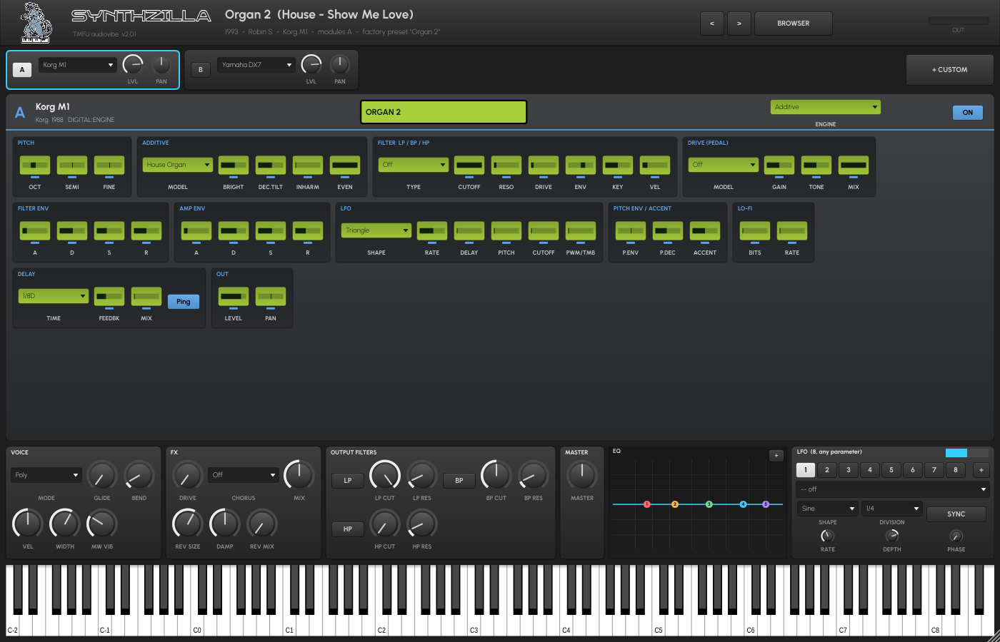
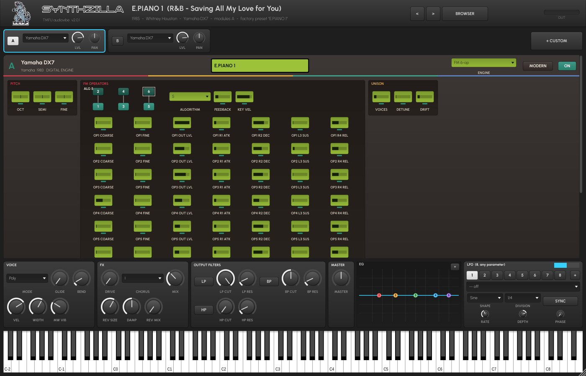
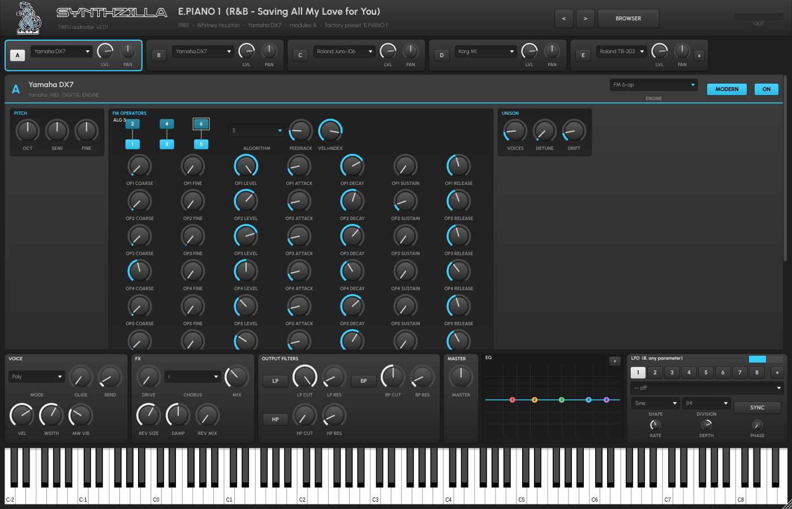
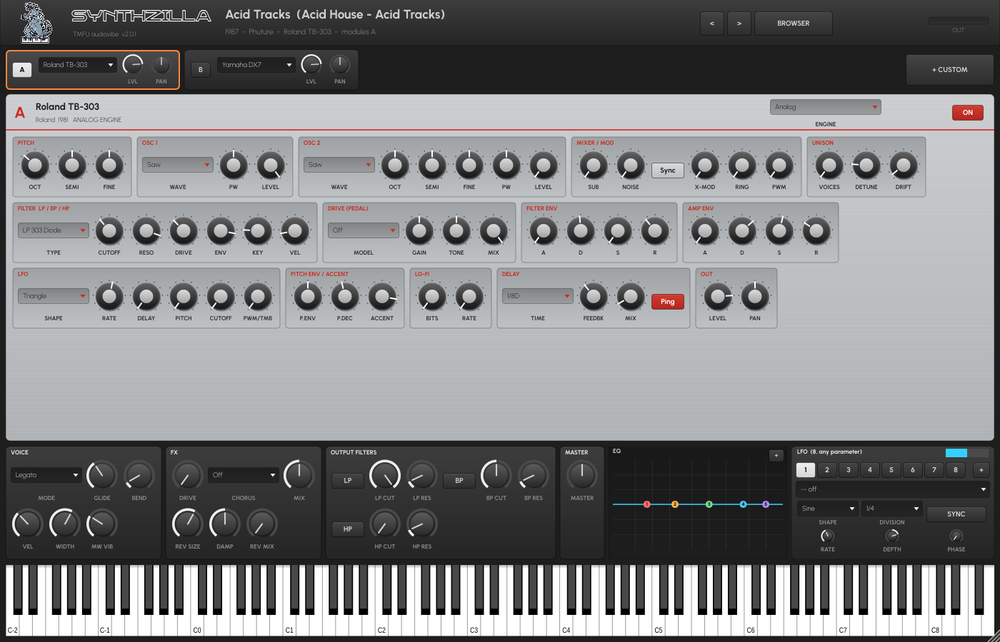
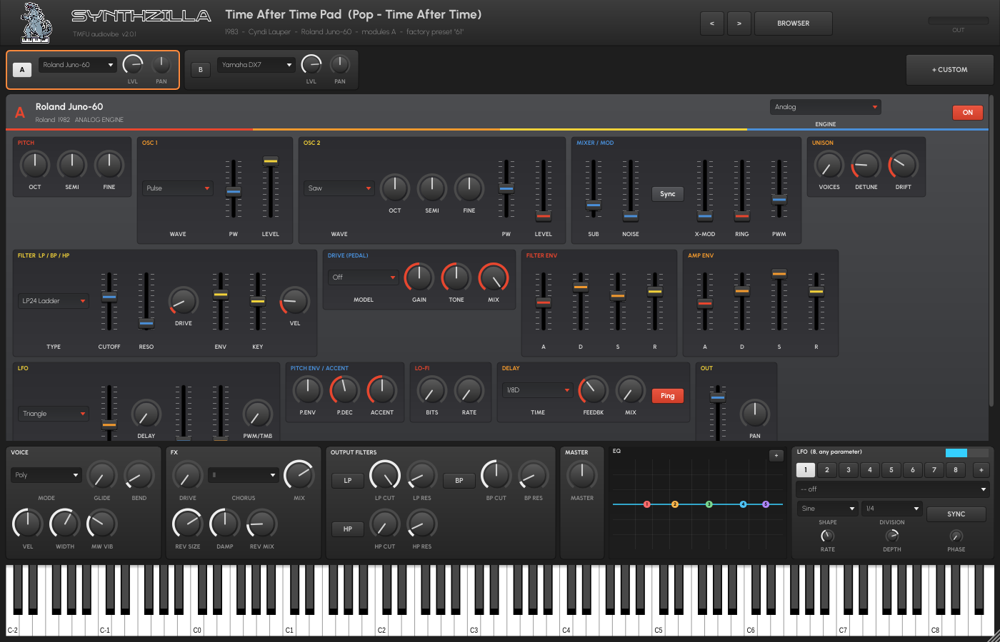
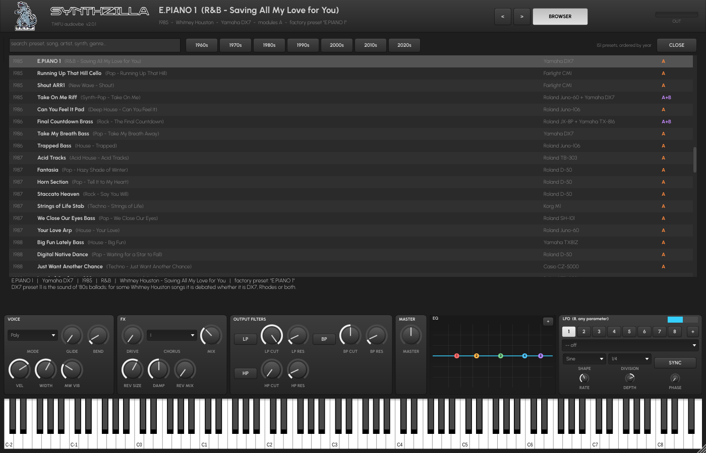
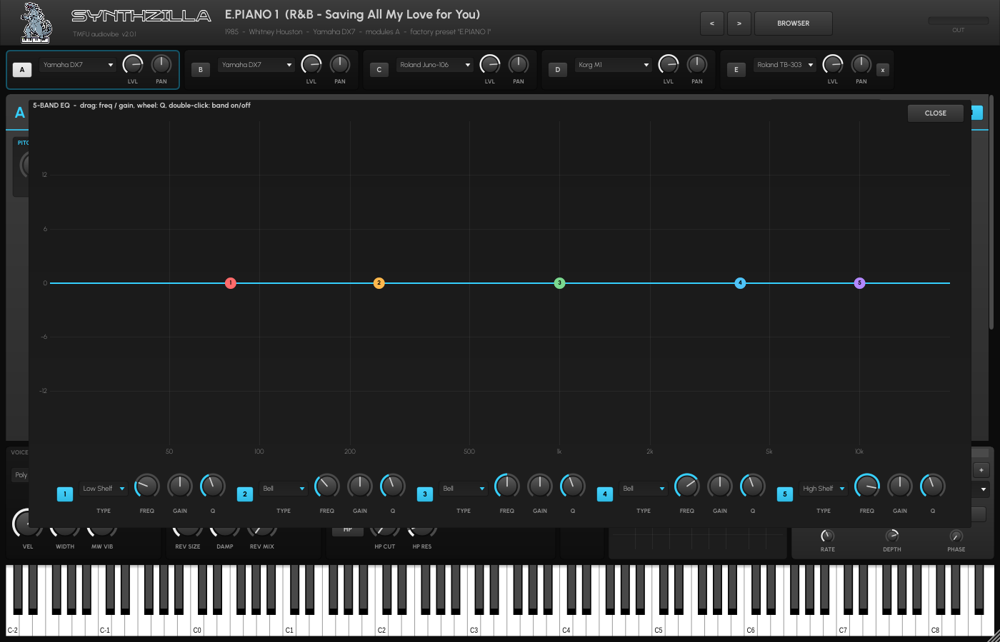

# SynthZilla — fino a 5 synth (analogici / digitali) con i suoni famosi 1960–2020 (VST3 / AU / Standalone)

SynthZilla (TMFU audiovibe, JUCE 8 / C++17) ricrea **per sintesi** — senza campioni — i suoni di synth più famosi della
storia, ognuno legato al **brano più famoso che l'ha usato**. La libreria è ordinata **per anno**.



## Moduli synth A–E

- Ci sono 2 moduli all'avvio (A, B); il pulsante **+ CUSTOM** ne aggiunge altri 3 (C, D, E); la **x** sulla scheda toglie l'ultimo.
- Ogni modulo ha un menu **Synth Model**: scegli uno qualsiasi degli strumenti presenti nei preset (Minimoog, TB-303, DX7,
  M1, D-50, Juno, Jupiter-8, CS-80, PPG, Fairlight, Virus, Sylenth1, Serum…). Il modulo carica il suono caratteristico di
  quello strumento e ne prende l'aspetto grafico.
- Strumento originale analogico → motore **Analog**; digitale → motore digitale (**FM 6-op**, **Wavetable**, **Supersaw**,
  **Phase Dist**, **Additive**); combinazione analogico + digitale (synth ibridi o strumenti sovrapposti sul disco) → più
  moduli in **layer**. Il generatore della libreria controlla questa regola.
- Ogni modulo ha: pitch, oscillatori/motore, unison, **filtro LP / BP / HP** (LP24 ladder, **LP 303 diode**, LP12, BP12,
  HP12, LP24 clean, notch), **drive a pedale** (Tube, **RAT**, **DS-1**), inviluppi filtro e ampiezza, LFO, pitch env,
  accent, lo-fi, **delay** (tempo, feedback, mix, ping-pong), **level** e **pan**.

### FM a 6 operatori: DX7 o MODERN
I moduli FM hanno 6 operatori e i **32 algoritmi** in stile DX7 (schema dell'algoritmo disegnato nel pannello).
- Modo **DX7**: parametri come sul DX7 — COARSE / FINE 0–99, OUT LVL 0–99, rate R1/R2/R4 (99 = veloce), livello L3 0–99,
  FEEDBACK 0–7, celle a membrana con LCD.
- **MODERN**: gli stessi operatori presentati come in Operator di Ableton Live — ratio ×, fine +, livelli in dB, Attack /
  Decay / Release in ms, Sustain in dB, manopole pulite.

### TB-303
- **Filtro**: diode ladder a 4 poli con il primo polo un'ottava sopra gli altri (gli stadi del 303 non sono separati),
  passa-alto (~150 Hz) nel percorso di risonanza come nel circuito originale (lo "squelch" che toglie i bassi invece di
  gonfiarli), saturazione all'ingresso, compensazione del guadagno, risolto a feedback istantaneo e sovracampionato 2×.
  **Accent** con il circuito "sweep" (accent consecutivi si accumulano) e decay del filtro a 200 ms sulle note accentate.
- **Drive**: modelli dei pedali usati sull'acid — **RAT** (stadio LM308 con rami di pre-enfasi ~60 Hz / ~1,5 kHz e banda che
  si restringe col guadagno, diodi 1N914 al silicio, filtro Tone 475 Hz–20 kHz) e **DS-1** (booster + op-amp, diodi
  leggermente asimmetrici, tone stack LP/HP), sovracampionati 2×.
- Riferimenti: Open303 (TeeBeeFilter), analisi TPT del diode ladder di Will Pirkle e JC-303, analisi ElectroSmash del ProCo RAT.

## Uscita
**Drive**, **Chorus** (I / II / I+II stile Juno, Ensemble), **Reverb**, **EQ grafico a 5 bande** (statico; nodi trascinabili:
frequenza/guadagno, rotella = Q, doppio clic = on/off; il pulsante **+** apre la finestra grande con tipo, frequenza,
guadagno e Q di ogni banda), **filtri d'uscita LP / BP / HP** con cutoff e risonanza, Master, limiter di sicurezza.

## 8 LFO
Ogni LFO può modulare **qualsiasi parametro** del plugin (tutti i moduli, effetti, EQ, filtri d'uscita). Forme Triangle, Sine,
Saw Up/Down, Square, S&H, Random; rate libero o **SYNC** al tempo (8 battute … 1/32, terzine e puntati), depth bipolare,
fase. Il **+** apre la vista con tutti gli 8 LFO. LFO, EQ e filtri d'uscita non cambiano quando carichi un preset.

## Grafica
- Stile Twinbox (piatto, scuro, in stile Ableton) con un leggero **rilievo**; font **Urbanist** Light / Bold (SIL OFL) per tutto
  il testo dell'interfaccia, logo e display compresi. Tutte le scritte di moduli, parametri e preset sono in inglese.
- Ogni modulo prende l'aspetto dello strumento scelto (34 skin: legno Moog/Prophet, fader Juno/CS-80/Alpha Juno, TB-303
  argento, LCD e membrane DX7/M1, PPG blu, Virus/Nord rossi, CRT Fairlight…), senza loghi o grafiche originali.
- **Fader più lunghi** sugli strumenti che hanno fader. Risoluzione fine: le manopole si muovono a passi di **0,01**, i fader di
  **0,001**; dopo un clic le frecce muovono di 1 % (fader 0,1 %), Shift = 10× più fine; doppio clic = valore di default.
- Finestra **ridimensionabile** (dal 50 % al 200 %, la dimensione viene ricordata), con EQ e LFO espandibili.
- Logo: **SynthZilla** in Rostex Outline e il kaiju in piedi su una tastiera synth (`tools/make_logo.py`).

## Preset
151 preset dal 1963 al 2023, **ordinati per anno**. Nel browser ogni riga è:
`anno  Nome preset  (Genere - Brano)   strumento   moduli`. Ricerca testuale e salti rapidi per decennio.
- **Nomi reali** dei preset di fabbrica quando il suono è un preset documentato (Organ 2, Piano 16', Universe, Lore, Ooh/Aah,
  Choir, E.PIANO 1, BASS 1, Lately Bass, Solid Bass, What The, Fantasia, Pizzagogo, Digital Native Dance, Staccato Heaven,
  Horn Section, Living Calliope, Metal Harp, ORCH5, ARR1, Vox Humana, Sandstorm, LD Screamer, preset "61" del Juno-60).
- Generi bilanciati (Pop, Rock, Synth-Pop, New Wave, Funk/Soul, R&B, Disco, Film, Hip-Hop, House, Techno, Acid, Trance,
  Eurodance, Rave, Dubstep, EDM, Indie, Synthwave…), nessun genere favorito.
- Quando lo strumento di un brano non è documentato con certezza, la scheda del preset lo dice.
- **Tutti i preset sono normalizzati con picco a −1 dBFS** (misurato offline con una frase standard per tipo di suono).

Elenco completo: [docs/PRESETS.md](docs/PRESETS.md).

| | | |
|---|---|---|
|  DX7 |  FM MODERN, 5 moduli |  TB-303 |
|  Juno-60 (fader) |  Browser |  EQ |

## Fonti della ricerca
[MusicRadar – 10 best synth presets](https://www.musicradar.com/news/the-top-10-classic-synth-presets-and-where-you-can-hear-them),
[MusicRadar – 10 best TB-303 tracks](https://www.musicradar.com/news/10-of-the-best-roland-tb-303-tracks-of-all-time-fatboy-slim-voodoo-ray-aphex-twin-and-more),
[Gearnews – 5 synth presets that changed pop music](https://www.gearnews.com/5-synth-presets-that-changed-pop-music-synths/),
[Reverb Machine – DX7 songs](https://reverbmachine.com/blog/exploring-the-yamaha-dx7-pt2/),
[Sonicstate – Korg M1 famous sounds](https://sonicstate.com/news/2024/07/22/korg-m1-famous-songs-sounds/),
[Roland – Sounds of the D-50](https://articles.roland.com/listening-guide-sounds-of-the-d-50/),
[Sound On Sound – Darude Sandstorm](https://www.soundonsound.com/techniques/classic-tracks-darude-sandstorm),
[MusicRadar – Sandstorm and the JP-8080](https://www.musicradar.com/artists/when-you-turn-on-the-roland-jp-8080-the-first-sound-that-comes-up-is-called-sandstorm-how-darude-created-the-era-defining-trance-anthem-thats-named-after-a-synth-preset),
[ClassicTrance – JP-8000 Supersaw](https://www.classictrance.com/blog/jp-8000-supersaw-rewrote-trance),
[MusicRadar – Blinding Lights](https://www.musicradar.com/how-to/how-the-weeknd-recreated-80s-sound-blinding-lights),
[American Songwriter – Juno-60](https://americansongwriter.com/3-songs-that-use-the-juno-60-the-synthesizer-that-made-80s-pop-music-sound-magical/),
[Thomann – fat synth songs](https://www.thomann.de/blog/en/15-songs-with-a-fat-synth-sound/),
[Splice – Korg songs](https://splice.com/blog/iconic-songs-korg-synthesizers/),
[KVR – Open303](https://www.kvraudio.com/forum/viewtopic.php?t=262829&start=330), [JC-303](https://github.com/midilab/jc303),
[ElectroSmash – ProCo RAT](https://www.electrosmash.com/proco-rat-analysis/pedals/distortion/pro-co-rat-distortion.html).

## Compilazione e installazione

```bash
cmake -S SynthZilla -B SynthZilla/build -DCMAKE_BUILD_TYPE=Release
```

```bash
cmake --build SynthZilla/build --config Release --parallel
```

Su macOS la CI (`.github/workflows/synthzilla.yml`, runner Intel) produce l'installer universale
**SynthZilla-2.0.1-macOS.pkg** (Intel + Apple Silicon: AU, VST3, app Standalone). Nella DAW compare sotto **TMFU audiovibe**
(AU `aumu Szla Tmfu`).

Strumenti: `tools/gen_presets.py` (libreria + `docs/PRESETS.md`); test con `-DSYNTHZILLA_BUILD_TESTS=ON`:
`SynthZillaTest <dir> units | check | levels | wav <nome> | gui`.

> Marchi e nomi degli strumenti appartengono ai rispettivi proprietari e sono usati solo per indicare lo strumento di
> riferimento. Il kaiju del logo è un personaggio generico stilizzato. Font: vedi `resources/fonts/FONTS-LICENSE.txt`.
