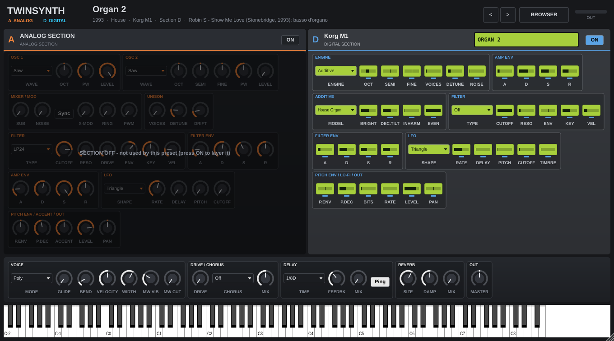
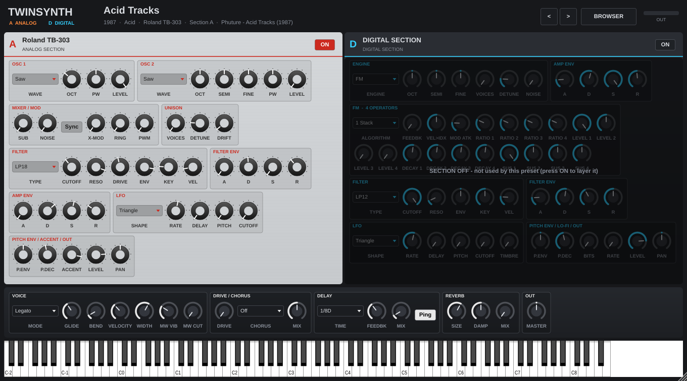
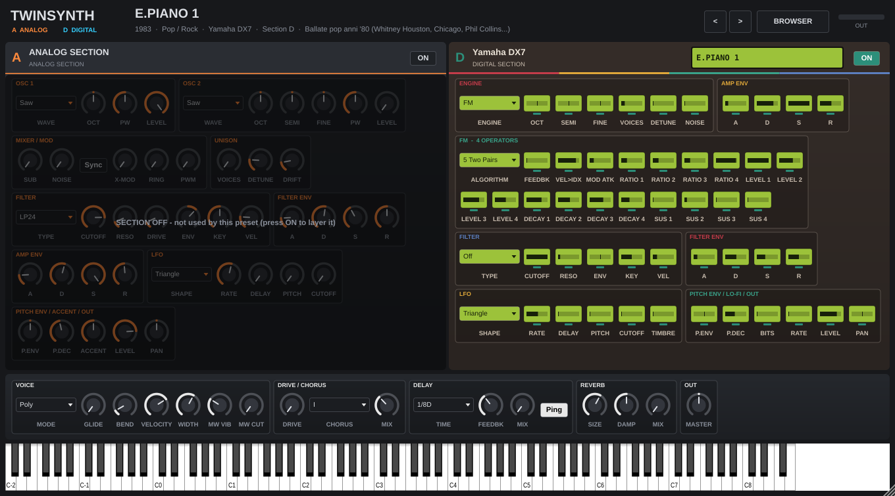
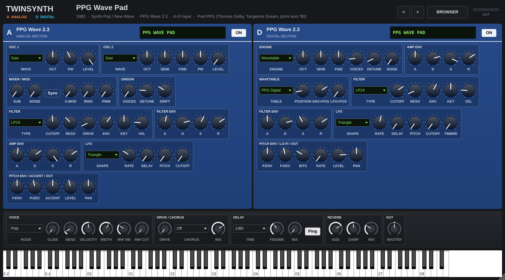
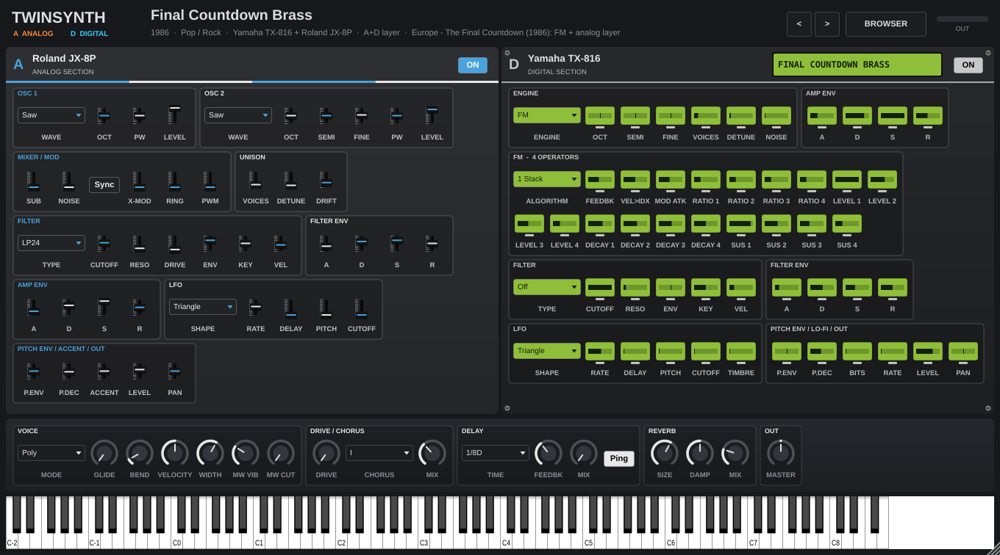
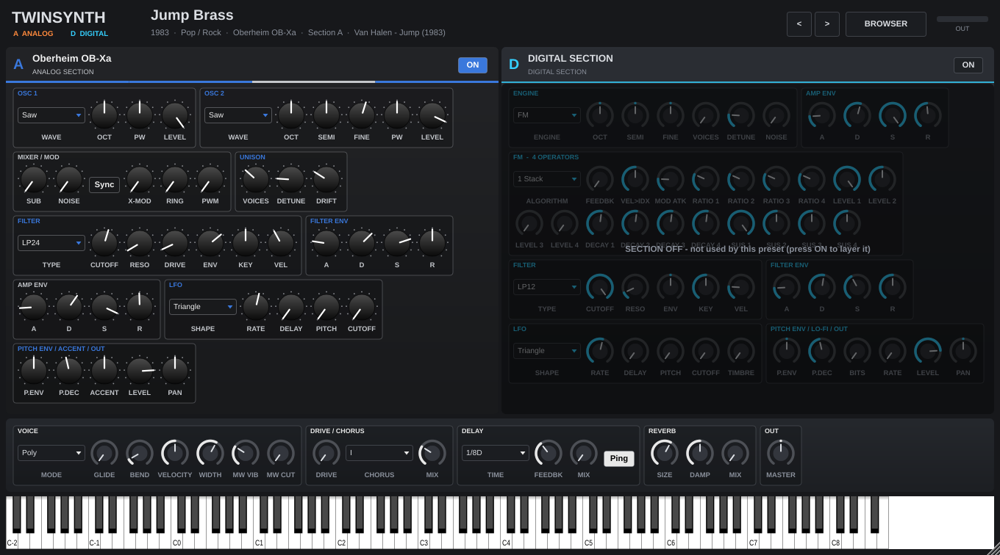
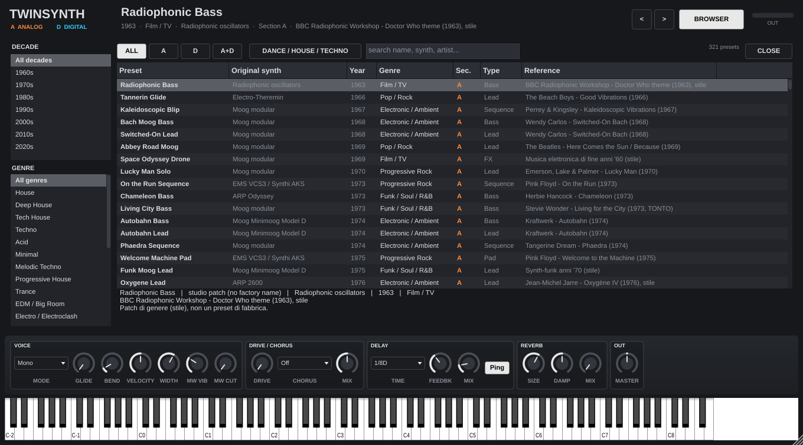

# TWINSYNTH — synth A (Analogico) + D (Digitale) con i suoni famosi dal 1960 al 2020 (VST3 / AU / Standalone)

Twinsynth è uno strumento JUCE 8 / C++17 con **due sezioni di sintesi** e una libreria di **321 preset** che ricreano per
sintesi (nessun campione) i suoni di synth più famosi, dagli anni '60 agli anni 2020, organizzati per **anno/decennio** e
**genere**. La libreria punta soprattutto su **House, Deep House, Tech House, Techno e Acid**.



## Le due sezioni

| Sezione | Quando suona | Motore |
|---|---|---|
| **A — Analogico** | il synth originale è **analogico** (Moog, ARP, Prophet, Oberheim, Jupiter, Juno, TB-303, SH-101, MS-20, CS-80, Alpha Juno…) | 2 VCO poly-BLEP (saw / pulse / tri / sine), sync, cross-mod, ring, sub, noise, unison fino a 7 voci con drift analogico, filtro ladder ZDF **LP24** / **LP18** (stile diode 303) / SVF LP12-BP-HP con saturazione, inviluppi a curva analogica, LFO con delay, pitch envelope, **accent** stile 303 |
| **D — Digitale** | il synth originale è **digitale** (DX7, TX81Z, M1, D-50, Fairlight, Synclavier, CZ, JP-8000, Virus, Nord Lead, Massive, Serum, Sylenth1…) | 5 motori: **FM a 4 operatori** (8 algoritmi, feedback, velocity→indice), **wavetable** band-limited (12 tabelle × 8 frame), **supersaw** stile JP-8000, **phase distortion** stile Casio CZ, **additivo** (organo house, piano, e.piano, archi, coro, campane…); filtro SVF digitale, bit crush e riduzione di frequenza |
| **A + D in layer** | il suono nasce da una **combinazione** analogico + digitale: synth ibridi (PPG Wave, Ensoniq ESQ-1, Korg DW-8000, Prophet VS: oscillatori digitali + filtri analogici) o layer di strumenti diversi (es. *The Final Countdown*: Yamaha TX-816 + Roland JX-8P) | ogni voce suona entrambe le sezioni |

La regola A / D / A+D è verificata dal generatore: un preset che dichiara un synth analogico non può accendere la sezione D,
e viceversa.

Sezione globale: modo Poly / Mono / Legato (slide stile 303), glide, bend, velocity, larghezza stereo, mod wheel → vibrato /
cutoff, Drive, **Chorus** (I / II / I+II stile Juno, Ensemble), **Delay** a tempo (ping-pong), **Reverb**, Master, limiter di
sicurezza. Tastiera a schermo.

## La grafica cambia con il preset

Quando cambi preset, ogni sezione prende l'aspetto dello **strumento originale**: colori del pannello, materiale (fianchi in
legno, metallo spazzolato, rack), tipo di controlli (manopole con gonna stile Moog, manopole a indice, cappucci colorati,
**fader** stile Juno / CS-80 / Alpha Juno, celle a membrana stile DX7 / M1), strisce colorate, **display LCD** con il nome
del preset per gli strumenti digitali, CRT verde per il Fairlight. Nei layer A+D le due sezioni prendono ciascuna l'aspetto del
proprio strumento.

| | | |
|---|---|---|
|  TB-303 |  DX7 |  PPG (A+D) |
|  JX-8P + TX-816 |  OB-Xa |  Browser |

Le skin (34 in tutto, `Source/Skins.h`) sono **omaggi ispirati** agli strumenti: non riproducono loghi, grafiche o marchi.

## Preset

- **Nomi reali**: quando il suono è un preset di fabbrica documentato, il preset porta il **nome di fabbrica reale** (es. Korg M1
  *Organ 2*, *Piano 16'*, *Universe*, *Lore*; Yamaha TX81Z *Lately Bass*, *Solid Bass*; DX7 *E.PIANO 1*, *BASS 1*, *BRASS 1*,
  *TUB BELLS*, *MARIMBA*, *CLAV 1*; Alpha Juno *What The*; D-50 *Fantasia*, *Pizzagogo*, *Digital Native Dance*,
  *Staccato Heaven*; Fairlight *ORCH5*; Polymoog *Vox Humana*; Triton *Noisy Stabber*). Il nome di fabbrica compare anche nel
  display LCD.
- Molti suoni famosi **non** erano preset di fabbrica ma patch create in studio (il basso di *I Feel Love*, Minimoog e Prophet
  non avevano memorie, i 303 di *Acid Tracks*…): in quel caso il preset ha il nome del brano / artista di riferimento.
- I preset di **genere** (marcati "stile") ricostruiscono il suono tipico di una scena con gli strumenti che l'hanno definita;
  per House, Techno, Tech House, Deep House e Acid c'è anche una serie per epoca (1988 → 2022) con lo stesso ruolo musicale
  suonato dagli strumenti di ogni periodo.
- Quando lo strumento usato in un brano non è documentato con certezza, la scheda del preset lo dice.

| | |
|---|---|
| Totale | 321 |
| Famiglia dance (House, Deep, Tech House, Techno, Acid, Minimal, Melodic, Trance, EDM, Eurodance, Disco…) | 241 |
| House / Deep House / Tech House / Techno / Acid / Minimal / Melodic Techno | 178 |
| Sezione A / D / A+D | 161 / 140 / 20 |
| Decenni | 1960s 7 · 1970s 25 · 1980s 79 · 1990s 87 · 2000s 40 · 2010s 57 · 2020s 26 |

Elenco completo con strumento, sezione, anno, genere e riferimento: [docs/PRESETS.md](docs/PRESETS.md).

**Browser** (pulsante BROWSER): filtri per **decennio**, **genere**, sezione (A / D / A+D), **DANCE / HOUSE / TECHNO**,
ricerca testuale (nome, synth, artista); clic = carica e ascolta, doppio clic = chiudi. Le frecce < > scorrono i preset.
I preset sono anche esposti come *program* dell'host. Tutti i preset sono calibrati allo stesso volume (parametro nascosto
`g_trim`).

## Fonti della ricerca

Attribuzioni verificate su: [MusicRadar – The 40 greatest synth sounds](https://www.musicradar.com/news/tech/the-40-greatest-synth-sounds-of-all-time-ever-306114),
[MusicRadar – The 10 best synth presets](https://www.musicradar.com/news/the-top-10-classic-synth-presets-and-where-you-can-hear-them),
[Gearnews – Famous synth presets](https://www.gearnews.com/famous-synth-presets/),
[Guitar Center – Korg M1 sounds history](https://GuitarCenter.com/riffs/gear-tips/keyboards--midi/korg-m1-sounds-history),
[Bonedo – Origins of Sound: der Hoover](https://www.bonedo.de/artikel/origins-of-sound-der-hoover),
[Perfect Circuit – Roland Juno history](https://www.perfectcircuit.com/signal/roland-juno-history),
[Perfect Circuit – Rave synthesizers](https://www.perfectcircuit.com/signal/rave-synthesizers),
[Reverb – The most iconic keyboard by decade](https://reverb.com/news/the-most-iconic-keyboard-by-decade),
[Attack Magazine – Jeff Mills, The Bells](https://www.attackmagazine.com/technique/synth-secrets/jeff-mills-the-bells-part-2/),
[Gearspace – 90's Euro Dance synths used](https://gearspace.com/threads/90s-euro-dance-synths-used.444927/page-4).

## Installazione (macOS)

Installer **`Twinsynth-1.0.0-macOS.pkg`** (universale: Mac Intel e Apple Silicon), prodotto dalla CI (artifact
*Twinsynth-1.0.0-macOS-Installer*) o in locale con `./packaging/macos/make_pkg.sh 1.0.0` dopo una build Release.
Installa AU in `/Library/Audio/Plug-Ins/Components`, VST3 in `/Library/Audio/Plug-Ins/VST3` e l'app Standalone in
`/Applications` (ogni parte si può deselezionare). Nel browser della DAW il plugin compare sotto il produttore
**TMFU audiovibe** (AU: `aumu Twsy Tmfu`).

## Compilazione

```bash
cmake -S Twinsynth -B Twinsynth/build -DCMAKE_BUILD_TYPE=Release
```

```bash
cmake --build Twinsynth/build --config Release --parallel
```

JUCE 8.0.4 viene scaricato automaticamente (oppure `-DJUCE_DIR=/percorso/JUCE`). Formati: VST3 + Standalone ovunque, AU su macOS.

Strumenti:
- `tools/gen_presets.py` → `resources/presets.json` e `docs/PRESETS.md`.
- `-DTWINSYNTH_BUILD_TESTS=ON` compila `TwinsynthTest`: `check` (render di tutti i preset: niente NaN, niente preset muti),
  `levels` (calibrazione del volume → `tools/levels.json`, poi rilanciare il generatore), `wav <nome>` (render in WAV),
  `gui` (screenshot delle skin).

> Tutti i marchi citati (Moog, ARP, Sequential, Oberheim, Roland, Korg, Yamaha, Casio, Fairlight, Synclavier, PPG, Access,
> Clavia, Native Instruments, Xfer, LennarDigital…) appartengono ai rispettivi proprietari e sono usati solo per indicare
> lo strumento di riferimento. Twinsynth non contiene campioni, codice o grafica originali di questi strumenti.
